# Kit pieces

Generated on 2026-10-20 by `tools/pieces_catalogue.py` from the Unity package's `Data/pieces.json` (what was last
exported), with a thumbnail per piece from `tools/render_thumbs.py`. Do not edit by hand: re-export, then run both.
Browse it with pictures in [catalogue/index.html](catalogue/index.html) (open the file in a browser).

Size is the piece's bounding box in metres in Blender's axes (x across, y deep, z up; fronts face -y). Tris is
the exported triangle count. Mats is the number of materials on the piece. Prefabs are at
`Packages/com.danielgruginski.medievalkit/Generated/Prefabs/<kit>/<category>/<name>.prefab`.

**1405 pieces**: Building kit 464, Nature 61, Terrain tiles 33, Interior kit 847. Not listed: 37 meshes unique to one map (`U_VKV_*` valley chunks, paving and water; `U_VARI_*`).

## Building kit (`SM_VK_*`): 464

Houses, walls, roofs, defences, market, harbour, props (`src/core`, `src/modules`).

[Animal](#building-animal) 6 · [Awning](#building-awning) 1 · [Balcony](#building-balcony) 1 · [Banner](#building-banner) 3 · [BellTower](#building-belltower) 1 · [Boat](#building-boat) 1 · [BreadOven](#building-breadoven) 1 · [Breakwater](#building-breakwater) 2 · [Bridge](#building-bridge) 7 · [BuildSite](#building-buildsite) 1 · [Cargo](#building-cargo) 2 · [Ceiling](#building-ceiling) 1 · [Chapel](#building-chapel) 4 · [Chimney](#building-chimney) 5 · [Corner](#building-corner) 14 · [Crop](#building-crop) 9 · [Deco](#building-deco) 6 · [Def](#building-def) 8 · [Dock](#building-dock) 4 · [Emblem](#building-emblem) 10 · [Entrance](#building-entrance) 6 · [Foundation](#building-foundation) 3 · [Gallery](#building-gallery) 3 · [Gatehouse](#building-gatehouse) 3 · [Grave](#building-grave) 3 · [GuardTower](#building-guardtower) 1 · [Harbour](#building-harbour) 12 · [InnerCorner](#building-innercorner) 6 · [Jetty](#building-jetty) 3 · [Kiln](#building-kiln) 1 · [LeanTo](#building-leanto) 3 · [LowWall](#building-lowwall) 4 · [MarketHall](#building-markethall) 1 · [MarketStall](#building-marketstall) 15 · [Mill](#building-mill) 1 · [Mine](#building-mine) 1 · [Palisade](#building-palisade) 8 · [Parapet](#building-parapet) 2 · [Passage](#building-passage) 1 · [Pier](#building-pier) 4 · [Pile](#building-pile) 30 · [Porch](#building-porch) 1 · [Prop](#building-prop) 120 · [Quarry](#building-quarry) 4 · [Quay](#building-quay) 3 · [Rail](#building-rail) 3 · [RetainingWall](#building-retainingwall) 2 · [Roof](#building-roof) 29 · [RoofS](#building-roofs) 4 · [RoofThatch](#building-roofthatch) 8 · [RoofThatchS](#building-roofthatchs) 3 · [Scaffold](#building-scaffold) 5 · [Ship](#building-ship) 2 · [Sign](#building-sign) 3 · [Smithy](#building-smithy) 2 · [Stair](#building-stair) 2 · [Stockpile](#building-stockpile) 1 · [Stoop](#building-stoop) 1 · [Tent](#building-tent) 2 · [TownWall](#building-townwall) 8 · [Turret](#building-turret) 4 · [Wall](#building-wall) 53 · [WatPosts](#building-watposts) 1 · [WatRoofS](#building-watroofs) 2 · [WaterWheel](#building-waterwheel) 1 · [Windmill](#building-windmill) 2

### Animal: 6

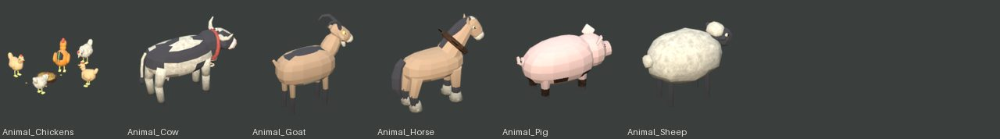

| Piece | Size (m) | Tris | Mats |
|---|---|---|---|
| `SM_VK_Animal_Chickens` | 1.91 × 1.56 × 0.71 | 2,024 | 9 |
| `SM_VK_Animal_Cow` | 2.61 × 1.03 × 1.57 | 1,992 | 6 |
| `SM_VK_Animal_Goat` | 1.31 × 0.47 × 1.33 | 1,264 | 4 |
| `SM_VK_Animal_Horse` | 2.95 × 0.89 × 2.52 | 1,836 | 6 |
| `SM_VK_Animal_Pig` | 1.67 × 0.74 × 0.85 | 1,254 | 5 |
| `SM_VK_Animal_Sheep` | 1.45 × 0.83 × 1.07 | 1,172 | 3 |

### Awning: 1

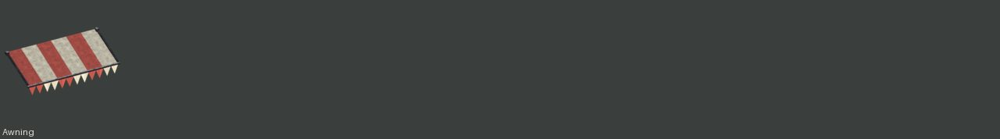

| Piece | Size (m) | Tris | Mats |
|---|---|---|---|
| `SM_VK_Awning` | 2.48 × 1.12 × 0.72 | 196 | 3 |

### Balcony: 1

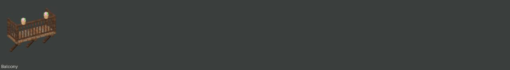

| Piece | Size (m) | Tris | Mats |
|---|---|---|---|
| `SM_VK_Balcony` | 2.30 × 1.05 × 2.27 | 1,440 | 5 |

### Banner: 3

| Piece | Size (m) | Tris | Mats |
|---|---|---|---|
| `SM_VK_Banner_Pole` | 2.13 × 0.91 × 7.14 | 596 | 6 |
| `SM_VK_Banner_Roof` | 1.98 × 1.05 × 3.60 | 332 | 5 |
| `SM_VK_Banner_Wall` | 0.16 × 1.27 × 2.48 | 584 | 5 |

### BellTower: 1

| Piece | Size (m) | Tris | Mats |
|---|---|---|---|
| `SM_VK_BellTower` | 4.20 × 4.50 × 19.04 | 5,821 | 8 |

### Boat: 1

| Piece | Size (m) | Tris | Mats |
|---|---|---|---|
| `SM_VK_Boat_Fishing` | 7.72 × 4.00 × 6.70 | 3,162 | 10 |

### BreadOven: 1

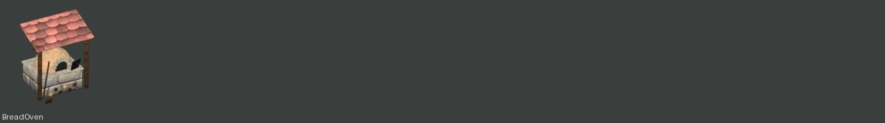

| Piece | Size (m) | Tris | Mats |
|---|---|---|---|
| `SM_VK_BreadOven` | 2.70 × 2.25 × 3.06 | 1,345 | 9 |

### Breakwater: 2

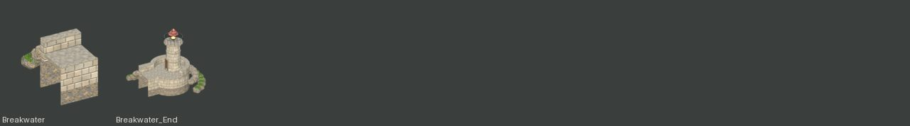

| Piece | Size (m) | Tris | Mats |
|---|---|---|---|
| `SM_VK_Breakwater` | 3.29 × 7.15 × 4.33 | 1,160 | 4 |
| `SM_VK_Breakwater_End` | 10.26 × 10.85 × 10.57 | 3,972 | 10 |

### Bridge: 7

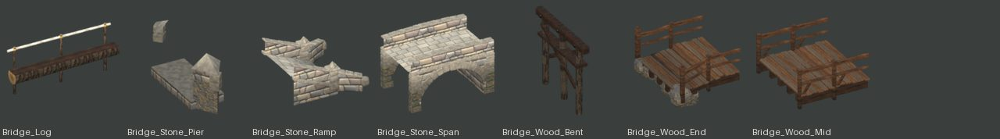

| Piece | Size (m) | Tris | Mats |
|---|---|---|---|
| `SM_VK_Bridge_Log` | 4.51 × 0.88 × 1.98 | 344 | 5 |
| `SM_VK_Bridge_Stone_Pier` | 1.90 × 6.72 × 3.00 | 466 | 3 |
| `SM_VK_Bridge_Stone_Ramp` | 4.71 × 5.72 × 2.73 | 2,304 | 3 |
| `SM_VK_Bridge_Stone_Span` | 6.00 × 4.26 × 3.86 | 7,480 | 4 |
| `SM_VK_Bridge_Wood_Bent` | 0.46 × 3.60 × 2.98 | 608 | 4 |
| `SM_VK_Bridge_Wood_End` | 3.24 × 4.07 × 2.28 | 2,200 | 3 |
| `SM_VK_Bridge_Wood_Mid` | 3.09 × 3.51 × 1.70 | 1,284 | 2 |

### BuildSite: 1

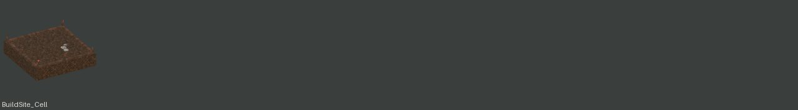

| Piece | Size (m) | Tris | Mats |
|---|---|---|---|
| `SM_VK_BuildSite_Cell` | 3.00 × 3.00 × 0.99 | 736 | 4 |

### Cargo: 2

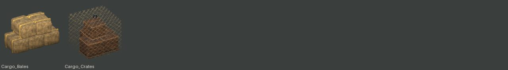

| Piece | Size (m) | Tris | Mats |
|---|---|---|---|
| `SM_VK_Cargo_Bales` | 2.25 × 1.13 × 1.24 | 980 | 2 |
| `SM_VK_Cargo_Crates` | 1.97 × 1.85 × 1.89 | 750 | 4 |

### Ceiling: 1

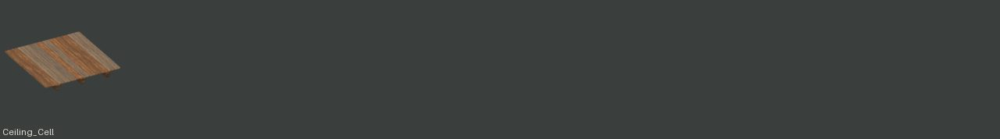

| Piece | Size (m) | Tris | Mats |
|---|---|---|---|
| `SM_VK_Ceiling_Cell` | 3.00 × 3.00 × 0.28 | 660 | 2 |

### Chapel: 4

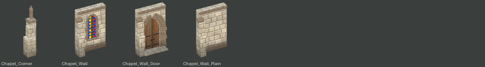

| Piece | Size (m) | Tris | Mats |
|---|---|---|---|
| `SM_VK_Chapel_Corner` | 1.52 × 1.52 × 6.35 | 590 | 2 |
| `SM_VK_Chapel_Wall` | 3.30 × 1.55 × 4.50 | 1,661 | 4 |
| `SM_VK_Chapel_Wall_Door` | 3.33 × 1.60 × 4.50 | 4,469 | 5 |
| `SM_VK_Chapel_Wall_Plain` | 3.30 × 1.55 × 4.50 | 688 | 2 |

### Chimney: 5

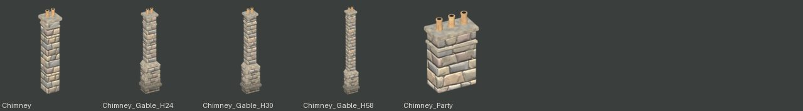

| Piece | Size (m) | Tris | Mats |
|---|---|---|---|
| `SM_VK_Chimney` | 1.30 × 1.30 × 6.36 | 508 | 4 |
| `SM_VK_Chimney_Gable_H24` | 1.94 × 1.49 × 8.70 | 1,688 | 4 |
| `SM_VK_Chimney_Gable_H30` | 1.94 × 1.49 × 9.30 | 1,948 | 4 |
| `SM_VK_Chimney_Gable_H58` | 1.94 × 1.49 × 12.10 | 1,776 | 4 |
| `SM_VK_Chimney_Party` | 2.06 × 1.25 × 3.21 | 720 | 4 |

### Corner: 14

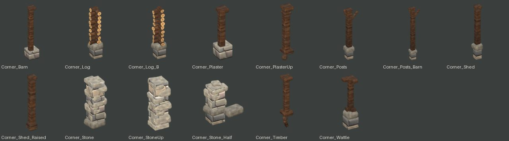

| Piece | Size (m) | Tris | Mats |
|---|---|---|---|
| `SM_VK_Corner_Barn` | 0.83 × 0.83 × 4.22 | 260 | 3 |
| `SM_VK_Corner_Log` | 0.89 × 0.94 × 3.64 | 1,106 | 4 |
| `SM_VK_Corner_Log_B` | 0.87 × 0.95 × 3.64 | 1,106 | 4 |
| `SM_VK_Corner_Plaster` | 0.83 × 0.80 × 3.02 | 260 | 3 |
| `SM_VK_Corner_PlasterUp` | 0.74 × 0.74 × 3.03 | 284 | 1 |
| `SM_VK_Corner_Posts` | 1.03 × 1.03 × 3.66 | 360 | 3 |
| `SM_VK_Corner_Posts_Barn` | 1.01 × 1.01 × 4.86 | 360 | 3 |
| `SM_VK_Corner_Shed` | 0.55 × 0.55 × 3.22 | 272 | 3 |
| `SM_VK_Corner_Shed_Raised` | 0.42 × 0.42 × 2.74 | 196 | 1 |
| `SM_VK_Corner_Stone` | 1.27 × 1.26 × 3.06 | 768 | 2 |
| `SM_VK_Corner_StoneUp` | 1.11 × 1.16 × 2.86 | 768 | 2 |
| `SM_VK_Corner_Stone_Half` | 1.92 × 1.74 × 2.40 | 596 | 2 |
| `SM_VK_Corner_Timber` | 0.74 × 0.74 × 3.78 | 284 | 1 |
| `SM_VK_Corner_Wattle` | 0.76 × 0.80 × 3.01 | 660 | 3 |

### Crop: 9

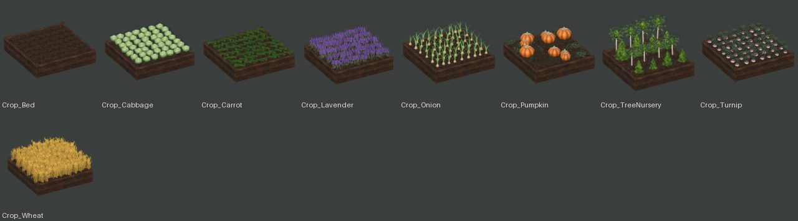

| Piece | Size (m) | Tris | Mats |
|---|---|---|---|
| `SM_VK_Crop_Bed` | 2.92 × 2.92 × 0.66 | 672 | 2 |
| `SM_VK_Crop_Cabbage` | 3.04 × 2.98 × 0.97 | 3,220 | 4 |
| `SM_VK_Crop_Carrot` | 2.96 × 2.92 × 1.09 | 2,352 | 3 |
| `SM_VK_Crop_Lavender` | 3.07 × 2.93 × 1.39 | 1,424 | 3 |
| `SM_VK_Crop_Onion` | 2.93 × 2.92 × 1.20 | 3,864 | 4 |
| `SM_VK_Crop_Pumpkin` | 2.92 × 2.99 × 1.18 | 2,944 | 5 |
| `SM_VK_Crop_TreeNursery` | 2.93 × 2.92 × 1.94 | 2,316 | 7 |
| `SM_VK_Crop_Turnip` | 2.92 × 2.92 × 1.01 | 4,298 | 4 |
| `SM_VK_Crop_Wheat` | 3.24 × 3.01 × 1.64 | 2,184 | 3 |

### Deco: 6

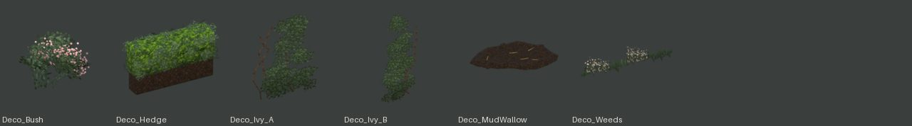

| Piece | Size (m) | Tris | Mats |
|---|---|---|---|
| `SM_VK_Deco_Bush` | 1.95 × 1.84 × 1.24 | 240 | 1 |
| `SM_VK_Deco_Hedge` | 3.34 × 1.10 × 1.92 | 840 | 3 |
| `SM_VK_Deco_Ivy_A` | 2.26 × 0.37 × 2.96 | 752 | 2 |
| `SM_VK_Deco_Ivy_B` | 1.75 × 0.38 × 4.23 | 904 | 2 |
| `SM_VK_Deco_MudWallow` | 3.50 × 2.56 × 0.17 | 418 | 2 |
| `SM_VK_Deco_Weeds` | 3.18 × 0.74 × 0.57 | 160 | 1 |

### Def: 8

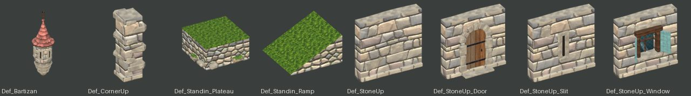

| Piece | Size (m) | Tris | Mats |
|---|---|---|---|
| `SM_VK_Def_Bartizan` | 2.24 × 2.24 × 7.03 | 1,362 | 6 |
| `SM_VK_Def_CornerUp` | 1.17 × 1.19 × 2.82 | 320 | 3 |
| `SM_VK_Def_Standin_Plateau` | 3.59 × 3.56 × 1.55 | 408 | 4 |
| `SM_VK_Def_Standin_Ramp` | 3.00 × 3.00 × 1.55 | 8 | 2 |
| `SM_VK_Def_StoneUp` | 3.00 × 0.68 × 2.80 | 324 | 3 |
| `SM_VK_Def_StoneUp_Door` | 3.00 × 1.01 × 2.80 | 1,222 | 5 |
| `SM_VK_Def_StoneUp_Slit` | 3.00 × 0.68 × 2.80 | 458 | 4 |
| `SM_VK_Def_StoneUp_Window` | 3.00 × 1.10 × 2.80 | 1,146 | 7 |

### Dock: 4

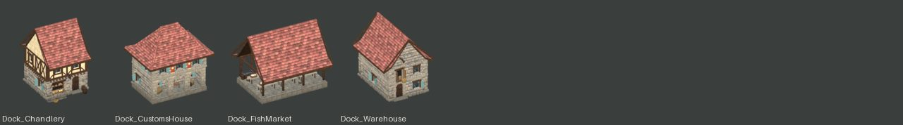

| Piece | Size (m) | Tris | Mats |
|---|---|---|---|
| `SM_VK_Dock_Chandlery` | 7.58 × 9.30 × 10.90 | 30,270 | 13 |
| `SM_VK_Dock_CustomsHouse` | 11.70 × 8.70 × 11.75 | 39,624 | 15 |
| `SM_VK_Dock_FishMarket` | 10.35 × 8.97 × 8.50 | 14,814 | 12 |
| `SM_VK_Dock_Warehouse` | 8.97 × 11.77 × 10.41 | 35,258 | 11 |

### Emblem: 10

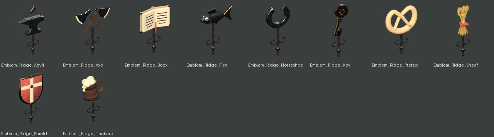

| Piece | Size (m) | Tris | Mats |
|---|---|---|---|
| `SM_VK_Emblem_Ridge_Anvil` | 1.12 × 0.22 × 2.22 | 784 | 4 |
| `SM_VK_Emblem_Ridge_Axe` | 1.35 × 0.16 × 1.84 | 1,036 | 5 |
| `SM_VK_Emblem_Ridge_Book` | 1.22 × 0.33 × 1.81 | 964 | 5 |
| `SM_VK_Emblem_Ridge_Fish` | 1.20 × 0.26 × 1.76 | 796 | 5 |
| `SM_VK_Emblem_Ridge_Horseshoe` | 0.83 × 0.16 × 1.78 | 1,112 | 4 |
| `SM_VK_Emblem_Ridge_Key` | 0.62 × 0.16 × 1.98 | 1,020 | 3 |
| `SM_VK_Emblem_Ridge_Pretzel` | 1.32 × 0.26 × 1.92 | 1,868 | 4 |
| `SM_VK_Emblem_Ridge_Sheaf` | 0.54 × 0.27 × 2.01 | 1,864 | 4 |
| `SM_VK_Emblem_Ridge_Shield` | 1.03 × 0.26 × 2.01 | 872 | 4 |
| `SM_VK_Emblem_Ridge_Tankard` | 0.95 × 0.61 × 1.93 | 1,444 | 4 |

### Entrance: 6

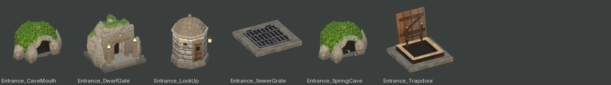

| Piece | Size (m) | Tris | Mats |
|---|---|---|---|
| `SM_VK_Entrance_CaveMouth` | 8.22 × 6.38 × 4.60 | 1,018 | 5 |
| `SM_VK_Entrance_DwarfGate` | 10.11 × 8.79 × 8.68 | 3,022 | 9 |
| `SM_VK_Entrance_LockUp` | 3.16 × 3.57 × 4.70 | 1,450 | 7 |
| `SM_VK_Entrance_SewerGrate` | 1.44 × 1.44 × 0.18 | 598 | 3 |
| `SM_VK_Entrance_SpringCave` | 8.22 × 6.38 × 4.60 | 1,164 | 6 |
| `SM_VK_Entrance_Trapdoor` | 1.45 × 1.44 × 1.27 | 928 | 6 |

### Foundation: 3

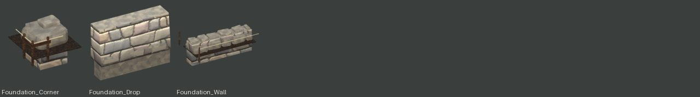

| Piece | Size (m) | Tris | Mats |
|---|---|---|---|
| `SM_VK_Foundation_Corner` | 1.54 × 1.54 × 1.24 | 484 | 5 |
| `SM_VK_Foundation_Drop` | 3.00 × 0.91 × 2.10 | 252 | 2 |
| `SM_VK_Foundation_Wall` | 3.04 × 1.87 × 1.24 | 2,092 | 5 |

### Gallery: 3

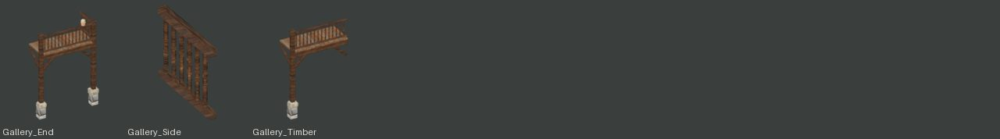

| Piece | Size (m) | Tris | Mats |
|---|---|---|---|
| `SM_VK_Gallery_End` | 3.47 × 1.55 × 4.97 | 1,808 | 7 |
| `SM_VK_Gallery_Side` | 0.12 × 1.30 × 0.97 | 144 | 1 |
| `SM_VK_Gallery_Timber` | 3.22 × 1.55 × 4.75 | 1,256 | 4 |

### Gatehouse: 3

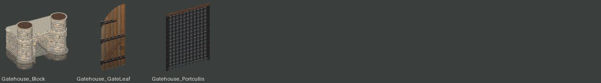

| Piece | Size (m) | Tris | Mats |
|---|---|---|---|
| `SM_VK_Gatehouse_Block` | 13.50 × 8.57 × 10.50 | 13,852 | 9 |
| `SM_VK_Gatehouse_GateLeaf` | 1.79 × 0.42 × 4.49 | 2,012 | 3 |
| `SM_VK_Gatehouse_Portcullis` | 3.72 × 0.21 × 4.94 | 1,392 | 2 |

### Grave: 3

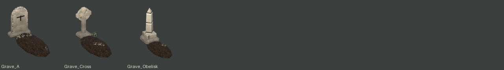

| Piece | Size (m) | Tris | Mats |
|---|---|---|---|
| `SM_VK_Grave_A` | 0.86 × 2.06 × 1.09 | 524 | 5 |
| `SM_VK_Grave_Cross` | 0.87 × 2.13 × 1.25 | 524 | 3 |
| `SM_VK_Grave_Obelisk` | 0.86 × 2.26 × 1.76 | 288 | 4 |

### GuardTower: 1

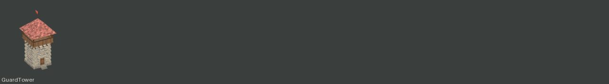

| Piece | Size (m) | Tris | Mats |
|---|---|---|---|
| `SM_VK_GuardTower` | 6.20 × 6.38 × 13.30 | 8,350 | 8 |

### Harbour: 12

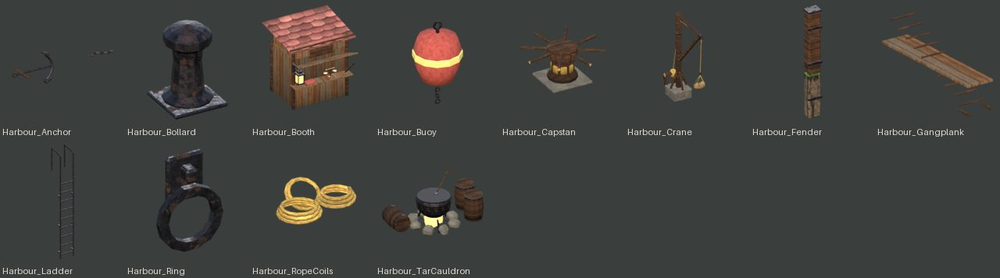

| Piece | Size (m) | Tris | Mats |
|---|---|---|---|
| `SM_VK_Harbour_Anchor` | 4.84 × 1.35 × 1.44 | 800 | 2 |
| `SM_VK_Harbour_Bollard` | 0.42 × 0.42 × 0.60 | 236 | 1 |
| `SM_VK_Harbour_Booth` | 2.81 × 2.82 × 2.89 | 1,524 | 8 |
| `SM_VK_Harbour_Buoy` | 1.00 × 1.00 × 1.85 | 596 | 3 |
| `SM_VK_Harbour_Capstan` | 2.47 × 2.47 × 1.12 | 740 | 4 |
| `SM_VK_Harbour_Crane` | 2.10 × 5.15 × 7.30 | 1,274 | 7 |
| `SM_VK_Harbour_Fender` | 0.32 × 0.25 × 2.44 | 528 | 3 |
| `SM_VK_Harbour_Gangplank` | 0.75 × 4.51 × 0.99 | 572 | 2 |
| `SM_VK_Harbour_Ladder` | 0.48 × 0.58 × 3.55 | 372 | 1 |
| `SM_VK_Harbour_Ring` | 0.28 × 0.09 × 0.40 | 200 | 1 |
| `SM_VK_Harbour_RopeCoils` | 1.67 × 1.33 × 0.43 | 1,138 | 1 |
| `SM_VK_Harbour_TarCauldron` | 2.95 × 1.59 × 1.50 | 1,284 | 5 |

### InnerCorner: 6

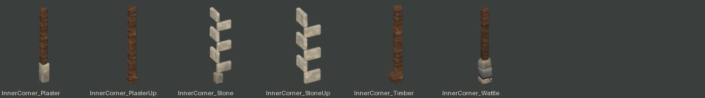

| Piece | Size (m) | Tris | Mats |
|---|---|---|---|
| `SM_VK_InnerCorner_Plaster` | 0.34 × 0.34 × 3.00 | 88 | 2 |
| `SM_VK_InnerCorner_PlasterUp` | 0.30 × 0.30 × 2.82 | 88 | 1 |
| `SM_VK_InnerCorner_Stone` | 0.69 × 0.68 × 2.95 | 692 | 1 |
| `SM_VK_InnerCorner_StoneUp` | 0.63 × 0.63 × 2.58 | 648 | 1 |
| `SM_VK_InnerCorner_Timber` | 0.47 × 0.47 × 2.80 | 152 | 1 |
| `SM_VK_InnerCorner_Wattle` | 0.45 × 0.44 × 3.01 | 228 | 3 |

### Jetty: 3

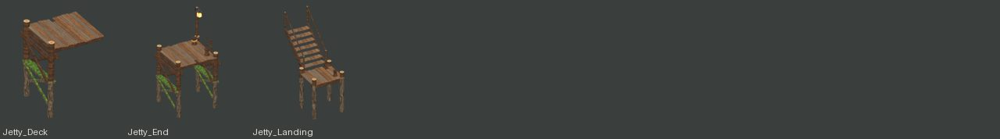

| Piece | Size (m) | Tris | Mats |
|---|---|---|---|
| `SM_VK_Jetty_Deck` | 3.26 × 3.30 × 4.37 | 1,124 | 4 |
| `SM_VK_Jetty_End` | 3.53 × 3.30 × 6.61 | 2,906 | 7 |
| `SM_VK_Jetty_Landing` | 2.10 × 3.96 × 5.05 | 1,308 | 4 |

### Kiln: 1

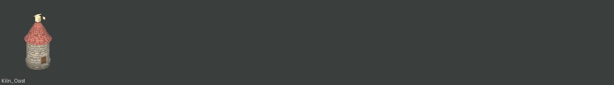

| Piece | Size (m) | Tris | Mats |
|---|---|---|---|
| `SM_VK_Kiln_Oast` | 5.30 × 5.57 × 11.27 | 1,452 | 9 |

### LeanTo: 3

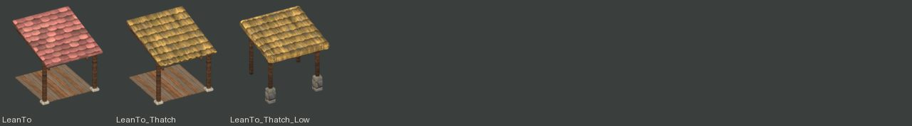

| Piece | Size (m) | Tris | Mats |
|---|---|---|---|
| `SM_VK_LeanTo` | 3.40 × 3.97 × 3.53 | 624 | 4 |
| `SM_VK_LeanTo_Thatch` | 3.40 × 3.97 × 3.53 | 624 | 4 |
| `SM_VK_LeanTo_Thatch_Low` | 3.73 × 3.44 × 3.76 | 2,330 | 4 |

### LowWall: 4

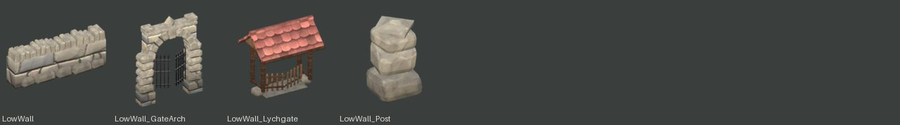

| Piece | Size (m) | Tris | Mats |
|---|---|---|---|
| `SM_VK_LowWall` | 3.01 × 0.77 × 1.21 | 1,244 | 2 |
| `SM_VK_LowWall_GateArch` | 3.38 × 0.77 × 4.25 | 2,608 | 3 |
| `SM_VK_LowWall_Lychgate` | 3.62 × 2.64 × 3.78 | 2,042 | 4 |
| `SM_VK_LowWall_Post` | 0.85 × 0.85 × 1.45 | 340 | 1 |

### MarketHall: 1

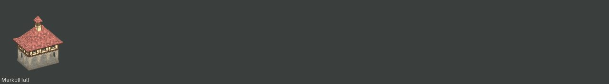

| Piece | Size (m) | Tris | Mats |
|---|---|---|---|
| `SM_VK_MarketHall` | 11.70 × 8.70 × 15.80 | 19,430 | 11 |

### MarketStall: 15

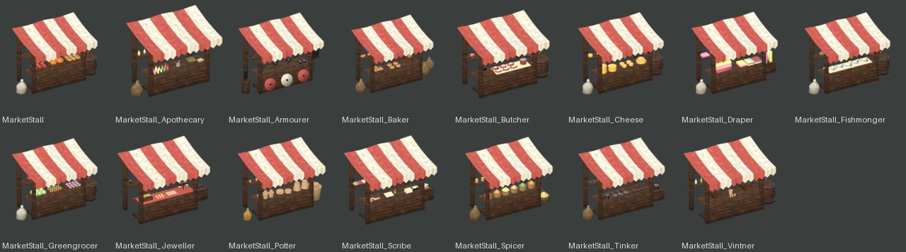

| Piece | Size (m) | Tris | Mats |
|---|---|---|---|
| `SM_VK_MarketStall` | 4.87 × 2.60 × 3.17 | 3,700 | 7 |
| `SM_VK_MarketStall_Apothecary` | 4.17 × 2.60 × 3.17 | 4,000 | 13 |
| `SM_VK_MarketStall_Armourer` | 4.88 × 2.60 × 3.15 | 2,696 | 5 |
| `SM_VK_MarketStall_Baker` | 5.14 × 2.60 × 3.17 | 4,312 | 8 |
| `SM_VK_MarketStall_Butcher` | 4.40 × 2.60 × 3.15 | 3,452 | 9 |
| `SM_VK_MarketStall_Cheese` | 4.87 × 2.60 × 3.17 | 3,852 | 8 |
| `SM_VK_MarketStall_Draper` | 4.82 × 2.60 × 3.17 | 3,064 | 9 |
| `SM_VK_MarketStall_Fishmonger` | 4.87 × 2.60 × 3.17 | 4,104 | 9 |
| `SM_VK_MarketStall_Greengrocer` | 4.87 × 2.60 × 3.17 | 5,336 | 7 |
| `SM_VK_MarketStall_Jeweller` | 4.38 × 2.60 × 3.16 | 2,928 | 7 |
| `SM_VK_MarketStall_Potter` | 4.70 × 2.60 × 3.17 | 3,456 | 7 |
| `SM_VK_MarketStall_Scribe` | 4.35 × 2.60 × 3.15 | 2,996 | 8 |
| `SM_VK_MarketStall_Spicer` | 4.72 × 2.60 × 3.17 | 3,860 | 14 |
| `SM_VK_MarketStall_Tinker` | 4.79 × 2.60 × 3.17 | 2,744 | 7 |
| `SM_VK_MarketStall_Vintner` | 4.40 × 2.60 × 3.15 | 3,188 | 7 |

### Mill: 1

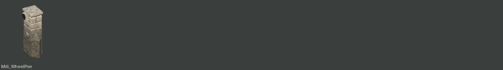

| Piece | Size (m) | Tris | Mats |
|---|---|---|---|
| `SM_VK_Mill_WheelPier` | 1.19 × 1.96 × 3.23 | 2,086 | 5 |

### Mine: 1

| Piece | Size (m) | Tris | Mats |
|---|---|---|---|
| `SM_VK_Mine_Portal` | 8.94 × 7.91 × 5.75 | 3,976 | 12 |

### Palisade: 8

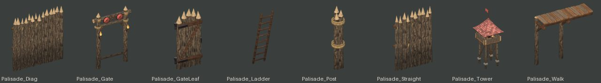

| Piece | Size (m) | Tris | Mats |
|---|---|---|---|
| `SM_VK_Palisade_Diag` | 4.27 × 0.51 × 4.55 | 1,838 | 5 |
| `SM_VK_Palisade_Gate` | 4.12 × 0.94 × 6.10 | 2,372 | 10 |
| `SM_VK_Palisade_GateLeaf` | 1.51 × 0.55 × 3.35 | 820 | 4 |
| `SM_VK_Palisade_Ladder` | 0.64 × 0.87 × 2.91 | 248 | 1 |
| `SM_VK_Palisade_Post` | 1.00 × 1.00 × 5.00 | 654 | 3 |
| `SM_VK_Palisade_Straight` | 3.00 × 0.50 × 4.54 | 1,338 | 5 |
| `SM_VK_Palisade_Tower` | 4.38 × 4.38 × 11.66 | 4,842 | 13 |
| `SM_VK_Palisade_Walk` | 3.11 × 1.10 × 2.90 | 816 | 4 |

### Parapet: 2

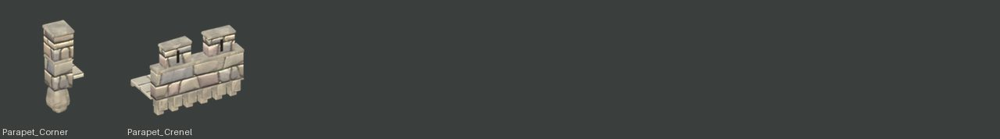

| Piece | Size (m) | Tris | Mats |
|---|---|---|---|
| `SM_VK_Parapet_Corner` | 1.40 × 1.39 × 2.81 | 424 | 3 |
| `SM_VK_Parapet_Crenel` | 3.00 × 1.68 × 2.37 | 932 | 4 |

### Passage: 1

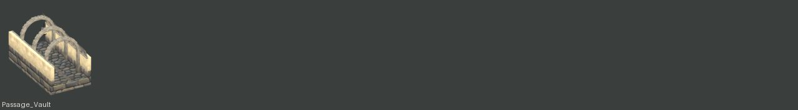

| Piece | Size (m) | Tris | Mats |
|---|---|---|---|
| `SM_VK_Passage_Vault` | 2.92 × 5.50 × 3.26 | 1,828 | 6 |

### Pier: 4

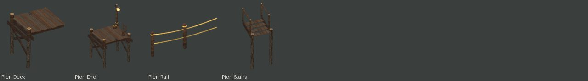

| Piece | Size (m) | Tris | Mats |
|---|---|---|---|
| `SM_VK_Pier_Deck` | 3.26 × 3.30 × 3.38 | 1,168 | 5 |
| `SM_VK_Pier_End` | 3.52 × 3.30 × 5.52 | 2,818 | 7 |
| `SM_VK_Pier_Rail` | 3.09 × 0.18 × 1.15 | 536 | 2 |
| `SM_VK_Pier_Stairs` | 1.68 × 1.52 × 4.05 | 544 | 4 |

### Pile: 30

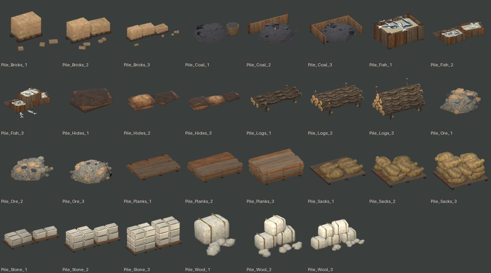

| Piece | Size (m) | Tris | Mats |
|---|---|---|---|
| `SM_VK_Pile_Bricks_1` | 1.33 × 1.20 × 0.64 | 600 | 3 |
| `SM_VK_Pile_Bricks_2` | 1.83 × 1.29 × 0.73 | 1,076 | 3 |
| `SM_VK_Pile_Bricks_3` | 3.28 × 1.29 × 0.73 | 1,552 | 3 |
| `SM_VK_Pile_Coal_1` | 2.09 × 1.43 × 0.68 | 736 | 3 |
| `SM_VK_Pile_Coal_2` | 2.75 × 2.15 × 0.93 | 1,140 | 4 |
| `SM_VK_Pile_Coal_3` | 3.39 × 2.72 × 1.03 | 1,792 | 4 |
| `SM_VK_Pile_Fish_1` | 0.85 × 0.71 × 0.37 | 968 | 4 |
| `SM_VK_Pile_Fish_2` | 1.76 × 1.14 × 0.37 | 1,980 | 4 |
| `SM_VK_Pile_Fish_3` | 1.78 × 1.57 × 0.68 | 3,308 | 4 |
| `SM_VK_Pile_Hides_1` | 1.19 × 1.00 × 0.37 | 492 | 1 |
| `SM_VK_Pile_Hides_2` | 2.28 × 0.97 × 0.49 | 984 | 1 |
| `SM_VK_Pile_Hides_3` | 3.26 × 1.09 × 0.59 | 1,584 | 1 |
| `SM_VK_Pile_Logs_1` | 2.94 × 1.46 × 0.56 | 368 | 2 |
| `SM_VK_Pile_Logs_2` | 2.95 × 1.85 × 0.90 | 792 | 2 |
| `SM_VK_Pile_Logs_3` | 2.95 × 1.85 × 1.48 | 1,080 | 2 |
| `SM_VK_Pile_Ore_1` | 1.89 × 1.55 × 0.68 | 776 | 4 |
| `SM_VK_Pile_Ore_2` | 2.65 × 2.08 × 0.81 | 1,064 | 4 |
| `SM_VK_Pile_Ore_3` | 3.16 × 2.62 × 1.22 | 1,480 | 6 |
| `SM_VK_Pile_Planks_1` | 2.90 × 1.95 × 0.34 | 612 | 2 |
| `SM_VK_Pile_Planks_2` | 2.90 × 1.95 × 0.63 | 1,044 | 2 |
| `SM_VK_Pile_Planks_3` | 2.90 × 1.95 × 0.96 | 1,560 | 2 |
| `SM_VK_Pile_Sacks_1` | 1.70 × 1.60 × 0.45 | 628 | 4 |
| `SM_VK_Pile_Sacks_2` | 1.71 × 1.69 × 0.71 | 1,188 | 4 |
| `SM_VK_Pile_Sacks_3` | 1.72 × 1.68 × 0.96 | 1,972 | 4 |
| `SM_VK_Pile_Stone_1` | 2.70 × 1.00 × 0.47 | 624 | 3 |
| `SM_VK_Pile_Stone_2` | 2.70 × 1.00 × 0.82 | 976 | 3 |
| `SM_VK_Pile_Stone_3` | 2.70 × 1.00 × 1.18 | 1,416 | 3 |
| `SM_VK_Pile_Wool_1` | 1.02 × 1.31 × 0.62 | 356 | 2 |
| `SM_VK_Pile_Wool_2` | 1.92 × 1.30 × 1.21 | 828 | 2 |
| `SM_VK_Pile_Wool_3` | 2.76 × 1.23 × 1.20 | 1,300 | 2 |

### Porch: 1

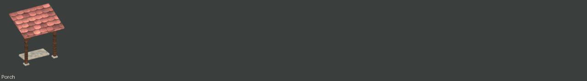

| Piece | Size (m) | Tris | Mats |
|---|---|---|---|
| `SM_VK_Porch` | 3.10 × 2.28 × 3.34 | 676 | 3 |

### Prop: 120

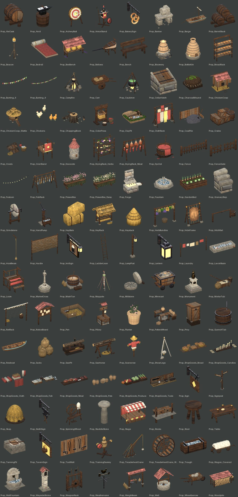

| Piece | Size (m) | Tris | Mats |
|---|---|---|---|
| `SM_VK_Prop_AleCask` | 1.25 × 1.76 × 1.43 | 1,276 | 4 |
| `SM_VK_Prop_Anvil` | 0.91 × 0.72 × 1.06 | 208 | 3 |
| `SM_VK_Prop_ArcheryButt` | 1.33 × 1.73 × 1.87 | 1,176 | 7 |
| `SM_VK_Prop_ArmorStand` | 1.64 × 0.94 × 2.36 | 1,520 | 8 |
| `SM_VK_Prop_BakerySign` | 0.48 × 1.48 × 1.12 | 544 | 2 |
| `SM_VK_Prop_Banker` | 1.73 × 1.36 × 1.46 | 860 | 4 |
| `SM_VK_Prop_Barge` | 9.85 × 3.60 × 5.58 | 2,956 | 7 |
| `SM_VK_Prop_BarrelStack` | 1.90 × 1.07 × 1.55 | 812 | 2 |
| `SM_VK_Prop_Beacon` | 2.70 × 2.57 × 7.65 | 2,027 | 10 |
| `SM_VK_Prop_Bedroll` | 0.74 × 1.66 × 0.25 | 352 | 4 |
| `SM_VK_Prop_BeeBench` | 2.77 × 1.35 × 1.81 | 1,580 | 6 |
| `SM_VK_Prop_Bellows` | 2.11 × 0.66 × 1.17 | 1,500 | 3 |
| `SM_VK_Prop_Bench` | 1.80 × 0.48 × 1.00 | 352 | 1 |
| `SM_VK_Prop_Bloomery` | 3.26 × 4.14 × 4.22 | 2,401 | 9 |
| `SM_VK_Prop_BottleKiln` | 5.00 × 5.66 × 6.90 | 3,640 | 6 |
| `SM_VK_Prop_BreadRack` | 1.50 × 0.51 × 1.91 | 1,792 | 3 |
| `SM_VK_Prop_Bunting_6` | 6.12 × 0.19 × 0.87 | 312 | 5 |
| `SM_VK_Prop_Bunting_9` | 9.12 × 0.20 × 1.17 | 328 | 5 |
| `SM_VK_Prop_Campfire` | 1.53 × 1.60 × 1.73 | 1,344 | 8 |
| `SM_VK_Prop_Cart` | 3.30 × 1.74 × 1.42 | 916 | 3 |
| `SM_VK_Prop_Cauldron` | 1.75 × 1.72 × 2.12 | 1,320 | 7 |
| `SM_VK_Prop_CellarHatch` | 1.54 × 1.56 × 1.29 | 852 | 4 |
| `SM_VK_Prop_CharcoalMound` | 4.59 × 4.24 × 2.19 | 3,628 | 7 |
| `SM_VK_Prop_ChickenCoop` | 2.37 × 2.48 × 2.21 | 744 | 5 |
| `SM_VK_Prop_ChickenCoop_Wattle` | 1.99 × 2.58 × 2.29 | 1,535 | 7 |
| `SM_VK_Prop_Chickens` | 1.41 × 2.19 × 0.54 | 1,480 | 4 |
| `SM_VK_Prop_ChoppingBlock` | 1.59 × 1.41 × 0.99 | 300 | 5 |
| `SM_VK_Prop_CiderPress` | 2.24 × 1.60 × 2.27 | 2,520 | 7 |
| `SM_VK_Prop_ClayPit` | 3.70 × 3.60 × 1.69 | 1,484 | 9 |
| `SM_VK_Prop_ClothRack` | 3.40 × 1.67 × 3.22 | 1,012 | 6 |
| `SM_VK_Prop_CoalPile` | 2.00 × 1.51 × 1.36 | 2,956 | 4 |
| `SM_VK_Prop_Crates` | 2.51 × 1.75 × 1.49 | 2,288 | 3 |
| `SM_VK_Prop_Creels` | 2.02 × 1.52 × 0.67 | 2,234 | 8 |
| `SM_VK_Prop_CrierStand` | 2.04 × 2.93 × 2.81 | 1,244 | 7 |
| `SM_VK_Prop_Dovecote` | 4.80 × 5.12 × 9.95 | 5,202 | 12 |
| `SM_VK_Prop_DryingRack_Herbs` | 1.68 × 0.88 × 1.93 | 2,168 | 6 |
| `SM_VK_Prop_DryingRack_Meat` | 2.70 × 1.19 × 2.21 | 2,540 | 4 |
| `SM_VK_Prop_DyeVat` | 1.61 × 1.50 × 1.61 | 1,216 | 3 |
| `SM_VK_Prop_Fence` | 3.18 × 0.28 × 1.18 | 832 | 1 |
| `SM_VK_Prop_FenceGate` | 3.20 × 0.28 × 1.30 | 832 | 1 |
| `SM_VK_Prop_Festoon` | 6.01 × 0.12 × 0.78 | 364 | 2 |
| `SM_VK_Prop_FishRack` | 3.20 × 1.61 × 2.18 | 3,092 | 4 |
| `SM_VK_Prop_FlowerBox` | 1.45 × 0.54 × 0.90 | 288 | 3 |
| `SM_VK_Prop_FlowerBox_Daisy` | 1.45 × 0.54 × 0.90 | 288 | 3 |
| `SM_VK_Prop_Forge` | 2.47 × 1.20 × 2.80 | 620 | 6 |
| `SM_VK_Prop_Fountain` | 5.80 × 5.80 × 2.88 | 5,192 | 4 |
| `SM_VK_Prop_GardenBed` | 2.84 × 1.62 × 1.17 | 1,448 | 7 |
| `SM_VK_Prop_GranaryStep` | 1.17 × 1.24 × 1.47 | 360 | 2 |
| `SM_VK_Prop_Grindstone` | 0.95 × 0.84 × 1.32 | 224 | 4 |
| `SM_VK_Prop_HandPump` | 1.39 × 1.95 × 2.17 | 870 | 4 |
| `SM_VK_Prop_HayBale` | 1.61 × 1.09 × 1.28 | 464 | 2 |
| `SM_VK_Prop_HayRack` | 2.76 × 2.05 × 2.70 | 2,092 | 5 |
| `SM_VK_Prop_Haystack` | 2.76 × 2.85 × 3.65 | 320 | 2 |
| `SM_VK_Prop_HerbBundles` | 2.50 × 0.86 × 2.10 | 596 | 5 |
| `SM_VK_Prop_HideFrame` | 1.70 × 0.95 × 2.04 | 556 | 4 |
| `SM_VK_Prop_HitchRail` | 3.09 × 0.67 × 1.10 | 332 | 3 |
| `SM_VK_Prop_HoistBeam` | 0.59 × 1.70 × 7.00 | 620 | 4 |
| `SM_VK_Prop_Hurdle` | 2.00 × 0.07 × 1.52 | 104 | 2 |
| `SM_VK_Prop_InnSign` | 0.30 × 2.15 × 1.30 | 3,448 | 7 |
| `SM_VK_Prop_LadderLean` | 0.50 × 0.77 × 2.79 | 168 | 1 |
| `SM_VK_Prop_LampPost` | 0.45 × 1.05 × 2.90 | 564 | 4 |
| `SM_VK_Prop_Lantern` | 0.32 × 0.68 × 0.61 | 324 | 2 |
| `SM_VK_Prop_Laundry` | 5.12 × 0.50 × 2.60 | 508 | 6 |
| `SM_VK_Prop_LavoirBasin` | 5.44 × 2.69 × 1.19 | 1,378 | 9 |
| `SM_VK_Prop_Loom` | 1.80 × 2.11 × 1.83 | 1,522 | 6 |
| `SM_VK_Prop_MarketCross` | 3.40 × 3.40 × 6.64 | 1,320 | 9 |
| `SM_VK_Prop_MashTun` | 3.09 × 2.70 × 2.03 | 1,206 | 7 |
| `SM_VK_Prop_Maypole` | 6.09 × 6.09 × 9.73 | 1,896 | 9 |
| `SM_VK_Prop_Millstone` | 2.22 × 1.67 × 1.33 | 724 | 4 |
| `SM_VK_Prop_Minecart` | 1.79 × 0.98 × 1.24 | 1,780 | 8 |
| `SM_VK_Prop_Monument` | 3.40 × 3.40 × 6.01 | 2,088 | 6 |
| `SM_VK_Prop_MortarTub` | 1.85 × 0.93 × 0.97 | 520 | 6 |
| `SM_VK_Prop_NetRack` | 3.70 × 1.04 × 2.81 | 1,396 | 7 |
| `SM_VK_Prop_NoticeBoard` | 2.09 × 0.90 × 2.63 | 280 | 3 |
| `SM_VK_Prop_Pen` | 4.07 × 4.33 × 1.52 | 1,046 | 5 |
| `SM_VK_Prop_Pillory` | 1.52 × 1.91 × 3.46 | 836 | 8 |
| `SM_VK_Prop_Planter` | 0.68 × 0.70 × 1.06 | 196 | 3 |
| `SM_VK_Prop_PottersWheel` | 1.69 × 1.20 × 1.10 | 1,020 | 5 |
| `SM_VK_Prop_Privy` | 1.51 × 1.67 × 2.96 | 1,000 | 6 |
| `SM_VK_Prop_QuenchTub` | 0.86 × 0.86 × 0.96 | 260 | 3 |
| `SM_VK_Prop_Rowboat` | 4.28 × 1.42 × 0.93 | 2,148 | 5 |
| `SM_VK_Prop_Sacks` | 1.12 × 1.02 × 1.27 | 400 | 1 |
| `SM_VK_Prop_SawPit` | 4.06 × 2.81 × 2.85 | 960 | 8 |
| `SM_VK_Prop_Sawhorse` | 1.71 × 0.83 × 1.22 | 696 | 5 |
| `SM_VK_Prop_Scarecrow` | 1.60 × 0.76 × 2.56 | 632 | 6 |
| `SM_VK_Prop_ShearLegs` | 3.01 × 2.76 × 5.23 | 580 | 8 |
| `SM_VK_Prop_ShopGoods_Bread` | 1.90 × 0.50 × 0.32 | 1,984 | 5 |
| `SM_VK_Prop_ShopGoods_Candles` | 1.90 × 0.41 × 0.46 | 768 | 5 |
| `SM_VK_Prop_ShopGoods_Cloth` | 1.74 × 0.59 × 0.85 | 472 | 5 |
| `SM_VK_Prop_ShopGoods_Fish` | 1.84 × 0.56 × 0.29 | 1,796 | 5 |
| `SM_VK_Prop_ShopGoods_Meat` | 1.80 × 0.44 × 0.26 | 600 | 4 |
| `SM_VK_Prop_ShopGoods_Pots` | 1.88 × 0.49 × 0.42 | 1,448 | 2 |
| `SM_VK_Prop_ShopGoods_Produce` | 1.97 × 0.59 × 0.36 | 2,032 | 5 |
| `SM_VK_Prop_ShopGoods_Tools` | 1.85 × 0.49 × 0.45 | 1,620 | 5 |
| `SM_VK_Prop_Sign` | 0.14 × 1.18 × 1.00 | 276 | 3 |
| `SM_VK_Prop_Signpost` | 1.96 × 1.92 × 3.03 | 1,424 | 4 |
| `SM_VK_Prop_Skep` | 0.66 × 0.66 × 0.50 | 296 | 3 |
| `SM_VK_Prop_SmithSign` | 0.12 × 1.07 × 1.18 | 384 | 2 |
| `SM_VK_Prop_SpinningWheel` | 1.08 × 0.52 × 1.41 | 856 | 2 |
| `SM_VK_Prop_StaddleStone` | 0.73 × 0.73 × 1.25 | 154 | 1 |
| `SM_VK_Prop_Stage` | 6.30 × 4.08 × 4.63 | 2,224 | 7 |
| `SM_VK_Prop_Stocks` | 2.27 × 1.27 × 1.65 | 804 | 5 |
| `SM_VK_Prop_Stool` | 0.48 × 0.50 × 0.55 | 168 | 1 |
| `SM_VK_Prop_Table` | 2.00 × 0.95 × 1.09 | 680 | 3 |
| `SM_VK_Prop_TanningPit` | 2.34 × 2.35 × 1.07 | 726 | 6 |
| `SM_VK_Prop_TavernSign` | 0.46 × 1.68 × 1.35 | 392 | 4 |
| `SM_VK_Prop_ToolWall` | 1.80 × 0.14 × 1.00 | 544 | 3 |
| `SM_VK_Prop_TrainingDummy` | 1.85 × 1.16 × 2.12 | 984 | 7 |
| `SM_VK_Prop_TreadwheelCrane` | 9.74 × 4.03 × 9.26 | 1,892 | 5 |
| `SM_VK_Prop_TreadwheelCrane_Wheel` | 3.60 × 1.40 × 3.60 | 2,376 | 3 |
| `SM_VK_Prop_Trough` | 2.02 × 0.90 × 0.73 | 246 | 3 |
| `SM_VK_Prop_Wagon_Covered` | 5.16 × 1.94 × 1.80 | 1,990 | 5 |
| `SM_VK_Prop_WallFountain` | 1.80 × 1.09 × 2.08 | 872 | 4 |
| `SM_VK_Prop_WaysideShrine` | 1.21 × 1.23 × 3.22 | 1,775 | 13 |
| `SM_VK_Prop_WeaponRack` | 1.52 × 0.53 × 2.15 | 332 | 2 |
| `SM_VK_Prop_Weathervane` | 1.07 × 1.03 × 1.79 | 116 | 2 |
| `SM_VK_Prop_WeighBeam` | 4.31 × 1.85 × 4.12 | 2,796 | 10 |
| `SM_VK_Prop_Well` | 3.39 × 2.65 × 4.05 | 5,856 | 5 |
| `SM_VK_Prop_Wheelbarrow` | 2.20 × 0.73 × 0.84 | 780 | 4 |
| `SM_VK_Prop_Woodpile` | 3.70 × 1.30 × 1.50 | 3,396 | 5 |

### Quarry: 4

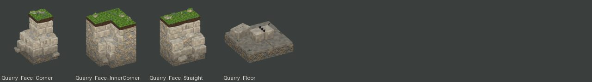

| Piece | Size (m) | Tris | Mats |
|---|---|---|---|
| `SM_VK_Quarry_Face_Corner` | 3.08 × 3.21 × 4.12 | 1,244 | 7 |
| `SM_VK_Quarry_Face_InnerCorner` | 3.07 × 3.12 × 4.06 | 1,104 | 6 |
| `SM_VK_Quarry_Face_Straight` | 3.00 × 3.17 × 4.15 | 1,096 | 7 |
| `SM_VK_Quarry_Floor` | 2.98 × 2.98 × 1.37 | 1,252 | 6 |

### Quay: 3

| Piece | Size (m) | Tris | Mats |
|---|---|---|---|
| `SM_VK_Quay_Post` | 0.67 × 0.70 × 1.78 | 384 | 2 |
| `SM_VK_Quay_Stair` | 3.00 × 1.30 × 2.08 | 1,040 | 4 |
| `SM_VK_Quay_Straight` | 3.00 × 1.01 × 2.03 | 720 | 4 |

### Rail: 3

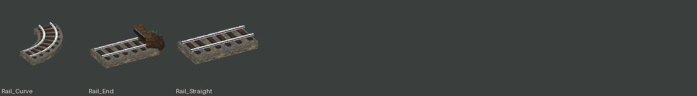

| Piece | Size (m) | Tris | Mats |
|---|---|---|---|
| `SM_VK_Rail_Curve` | 3.84 × 3.84 × 0.53 | 1,056 | 3 |
| `SM_VK_Rail_End` | 3.59 × 1.69 × 1.20 | 1,104 | 6 |
| `SM_VK_Rail_Straight` | 3.00 × 1.60 × 0.53 | 324 | 3 |

### RetainingWall: 2

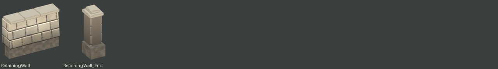

| Piece | Size (m) | Tris | Mats |
|---|---|---|---|
| `SM_VK_RetainingWall` | 3.00 × 0.87 × 2.26 | 468 | 3 |
| `SM_VK_RetainingWall_End` | 0.80 × 0.96 × 2.50 | 336 | 2 |

### Roof: 29

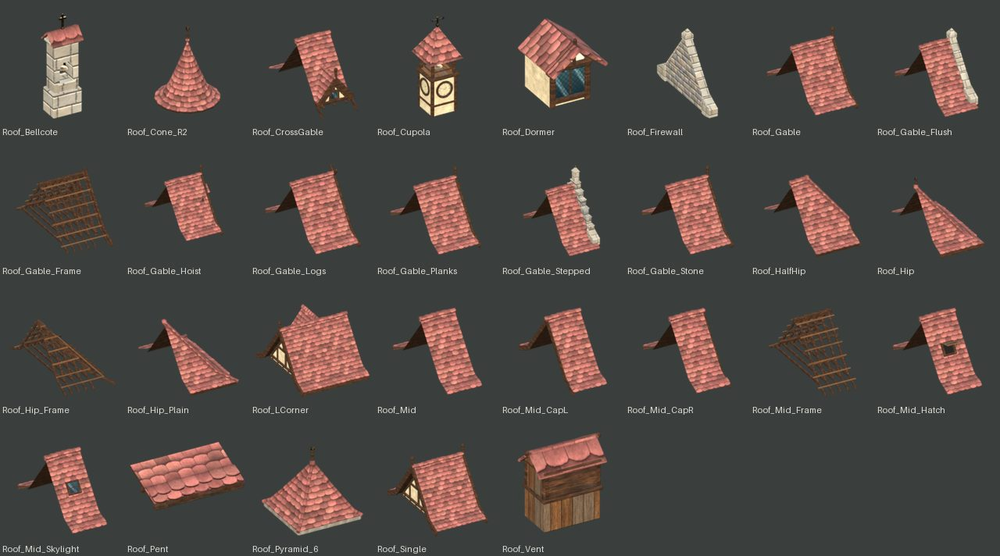

| Piece | Size (m) | Tris | Mats |
|---|---|---|---|
| `SM_VK_Roof_Bellcote` | 1.30 × 0.91 × 4.04 | 1,008 | 5 |
| `SM_VK_Roof_Cone_R2` | 4.40 × 4.40 × 5.37 | 532 | 3 |
| `SM_VK_Roof_CrossGable` | 3.31 × 8.80 × 5.09 | 3,912 | 4 |
| `SM_VK_Roof_Cupola` | 2.50 × 2.50 × 6.76 | 4,352 | 7 |
| `SM_VK_Roof_Dormer` | 2.51 × 2.85 × 3.01 | 499 | 4 |
| `SM_VK_Roof_Firewall` | 0.72 × 7.84 × 5.56 | 812 | 3 |
| `SM_VK_Roof_Gable` | 4.23 × 9.04 × 5.89 | 5,688 | 4 |
| `SM_VK_Roof_Gable_Flush` | 3.39 × 8.88 × 5.79 | 3,388 | 5 |
| `SM_VK_Roof_Gable_Frame` | 4.11 × 8.93 × 4.80 | 2,828 | 2 |
| `SM_VK_Roof_Gable_Hoist` | 5.08 × 9.04 × 7.48 | 6,540 | 7 |
| `SM_VK_Roof_Gable_Logs` | 4.16 × 9.04 × 5.44 | 5,542 | 5 |
| `SM_VK_Roof_Gable_Planks` | 4.59 × 9.04 × 5.89 | 5,528 | 5 |
| `SM_VK_Roof_Gable_Stepped` | 3.39 × 8.88 × 6.71 | 3,838 | 8 |
| `SM_VK_Roof_Gable_Stone` | 4.23 × 9.04 × 5.89 | 7,062 | 5 |
| `SM_VK_Roof_HalfHip` | 4.12 × 8.99 × 5.20 | 6,602 | 4 |
| `SM_VK_Roof_Hip` | 4.66 × 8.90 × 5.90 | 6,918 | 3 |
| `SM_VK_Roof_Hip_Frame` | 4.31 × 8.42 × 4.50 | 2,592 | 2 |
| `SM_VK_Roof_Hip_Plain` | 4.68 × 8.94 × 5.07 | 6,936 | 2 |
| `SM_VK_Roof_LCorner` | 7.23 × 9.04 × 5.89 | 6,354 | 4 |
| `SM_VK_Roof_Mid` | 3.06 × 8.90 × 5.00 | 2,368 | 2 |
| `SM_VK_Roof_Mid_CapL` | 3.19 × 9.02 × 5.10 | 3,032 | 2 |
| `SM_VK_Roof_Mid_CapR` | 3.19 × 9.02 × 5.10 | 3,032 | 2 |
| `SM_VK_Roof_Mid_Frame` | 3.00 × 8.39 × 4.44 | 1,684 | 2 |
| `SM_VK_Roof_Mid_Hatch` | 3.06 × 8.90 × 5.00 | 2,864 | 5 |
| `SM_VK_Roof_Mid_Skylight` | 3.06 × 8.90 × 5.00 | 2,690 | 4 |
| `SM_VK_Roof_Pent` | 3.24 × 1.72 × 1.05 | 1,612 | 2 |
| `SM_VK_Roof_Pyramid_6` | 4.21 × 4.21 × 4.14 | 772 | 4 |
| `SM_VK_Roof_Single` | 5.40 × 9.04 × 5.89 | 9,008 | 4 |
| `SM_VK_Roof_Vent` | 1.75 × 0.94 × 1.75 | 932 | 4 |

### RoofS: 4

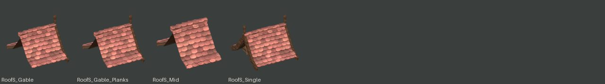

| Piece | Size (m) | Tris | Mats |
|---|---|---|---|
| `SM_VK_RoofS_Gable` | 3.88 × 5.14 × 3.75 | 4,202 | 3 |
| `SM_VK_RoofS_Gable_Planks` | 3.88 × 5.14 × 3.75 | 4,292 | 4 |
| `SM_VK_RoofS_Mid` | 3.06 × 5.00 × 2.86 | 2,368 | 2 |
| `SM_VK_RoofS_Single` | 4.70 × 5.14 × 3.75 | 6,116 | 4 |

### RoofThatch: 8

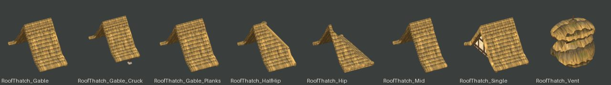

| Piece | Size (m) | Tris | Mats |
|---|---|---|---|
| `SM_VK_RoofThatch_Gable` | 4.18 × 9.11 × 5.16 | 4,536 | 4 |
| `SM_VK_RoofThatch_Gable_Cruck` | 4.18 × 9.11 × 6.87 | 5,148 | 6 |
| `SM_VK_RoofThatch_Gable_Planks` | 4.58 × 9.11 × 5.16 | 4,376 | 5 |
| `SM_VK_RoofThatch_HalfHip` | 4.22 × 9.08 × 5.28 | 6,142 | 4 |
| `SM_VK_RoofThatch_Hip` | 4.55 × 9.07 × 5.19 | 4,358 | 2 |
| `SM_VK_RoofThatch_Mid` | 3.03 × 8.91 × 5.11 | 2,464 | 2 |
| `SM_VK_RoofThatch_Single` | 5.32 × 9.13 × 5.17 | 6,568 | 4 |
| `SM_VK_RoofThatch_Vent` | 1.69 × 1.25 × 1.84 | 808 | 3 |

### RoofThatchS: 3

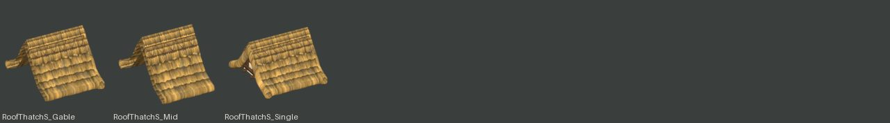

| Piece | Size (m) | Tris | Mats |
|---|---|---|---|
| `SM_VK_RoofThatchS_Gable` | 3.83 × 5.21 × 3.02 | 3,862 | 3 |
| `SM_VK_RoofThatchS_Mid` | 3.03 × 5.01 × 2.97 | 2,464 | 2 |
| `SM_VK_RoofThatchS_Single` | 4.62 × 5.23 × 3.03 | 5,264 | 3 |

### Scaffold: 5

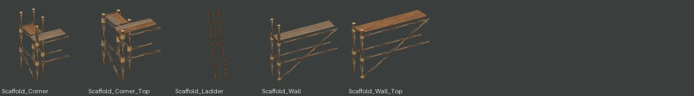

| Piece | Size (m) | Tris | Mats |
|---|---|---|---|
| `SM_VK_Scaffold_Corner` | 1.83 × 1.79 × 3.00 | 612 | 5 |
| `SM_VK_Scaffold_Corner_Top` | 1.83 × 1.79 × 2.30 | 612 | 5 |
| `SM_VK_Scaffold_Ladder` | 0.49 × 0.76 × 3.01 | 178 | 1 |
| `SM_VK_Scaffold_Wall` | 3.24 × 0.91 × 3.00 | 388 | 5 |
| `SM_VK_Scaffold_Wall_Top` | 3.24 × 0.91 × 2.30 | 388 | 5 |

### Ship: 2

| Piece | Size (m) | Tris | Mats |
|---|---|---|---|
| `SM_VK_Ship_Cog` | 20.16 × 9.60 × 17.50 | 5,216 | 7 |
| `SM_VK_Ship_Hull_Stocks` | 9.71 × 6.16 × 3.54 | 2,818 | 2 |

### Sign: 3

| Piece | Size (m) | Tris | Mats |
|---|---|---|---|
| `SM_VK_Sign_Anvil` | 0.25 × 1.48 × 1.00 | 420 | 4 |
| `SM_VK_Sign_Boot` | 0.22 × 1.48 × 1.00 | 364 | 4 |
| `SM_VK_Sign_Potion` | 0.40 × 1.48 × 1.00 | 396 | 4 |

### Smithy: 2

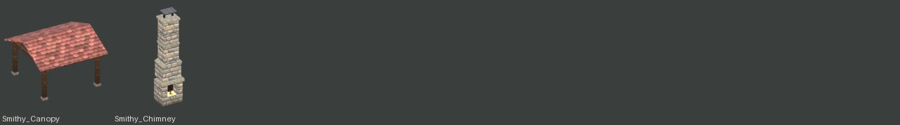

| Piece | Size (m) | Tris | Mats |
|---|---|---|---|
| `SM_VK_Smithy_Canopy` | 7.00 × 6.91 × 4.89 | 1,736 | 3 |
| `SM_VK_Smithy_Chimney` | 2.50 × 1.88 × 9.82 | 1,582 | 6 |

### Stair: 2

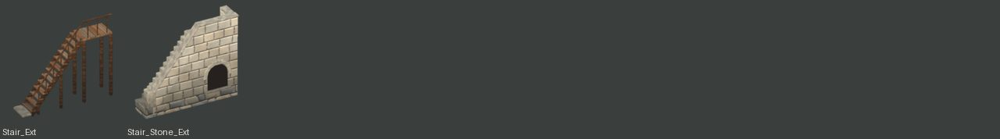

| Piece | Size (m) | Tris | Mats |
|---|---|---|---|
| `SM_VK_Stair_Ext` | 4.70 × 1.04 × 4.31 | 1,496 | 3 |
| `SM_VK_Stair_Stone_Ext` | 5.45 × 1.35 × 4.74 | 1,297 | 4 |

### Stockpile: 1

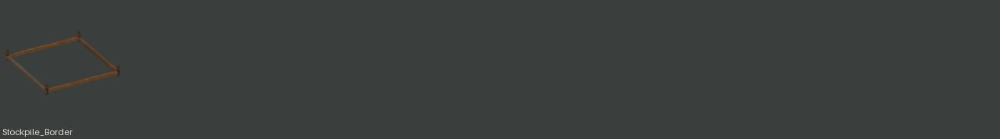

| Piece | Size (m) | Tris | Mats |
|---|---|---|---|
| `SM_VK_Stockpile_Border` | 2.93 × 2.92 × 0.41 | 400 | 2 |

### Stoop: 1

| Piece | Size (m) | Tris | Mats |
|---|---|---|---|
| `SM_VK_Stoop_Stone` | 2.46 × 1.13 × 1.26 | 448 | 2 |

### Tent: 2

| Piece | Size (m) | Tris | Mats |
|---|---|---|---|
| `SM_VK_Tent_A` | 2.88 × 5.42 × 2.27 | 871 | 8 |
| `SM_VK_Tent_Bell` | 4.95 × 4.33 × 3.44 | 718 | 7 |

### TownWall: 8

| Piece | Size (m) | Tris | Mats |
|---|---|---|---|
| `SM_VK_TownWall_Corner_In` | 1.68 × 1.68 × 7.75 | 1,036 | 3 |
| `SM_VK_TownWall_Corner_Out` | 2.69 × 2.68 × 9.66 | 1,304 | 4 |
| `SM_VK_TownWall_Postern` | 3.00 × 2.67 × 9.45 | 4,060 | 6 |
| `SM_VK_TownWall_Ruin` | 3.53 × 5.28 × 6.99 | 2,540 | 4 |
| `SM_VK_TownWall_Stair` | 3.07 × 1.17 × 6.43 | 446 | 2 |
| `SM_VK_TownWall_Step` | 3.45 × 2.82 × 10.57 | 2,336 | 4 |
| `SM_VK_TownWall_Straight` | 3.45 × 2.82 × 9.45 | 2,308 | 4 |
| `SM_VK_TownWall_Tower_Round` | 7.16 × 7.14 × 13.97 | 9,282 | 9 |

### Turret: 4

| Piece | Size (m) | Tris | Mats |
|---|---|---|---|
| `SM_VK_Turret_Cap` | 3.28 × 3.28 × 4.01 | 440 | 4 |
| `SM_VK_Turret_Corbel` | 2.40 × 2.40 × 1.81 | 476 | 2 |
| `SM_VK_Turret_Seg` | 2.58 × 2.40 × 2.80 | 1,124 | 3 |
| `SM_VK_Turret_Seg_Stone` | 2.48 × 2.40 × 2.84 | 552 | 3 |

### Wall: 53

| Piece | Size (m) | Tris | Mats |
|---|---|---|---|
| `SM_VK_Wall_Arcade` | 3.08 × 3.25 × 3.16 | 3,194 | 9 |
| `SM_VK_Wall_Barn` | 3.16 × 0.69 × 4.31 | 1,270 | 5 |
| `SM_VK_Wall_Barn_Door` | 3.13 × 2.26 × 4.31 | 1,650 | 6 |
| `SM_VK_Wall_Log` | 3.00 × 0.53 × 3.64 | 1,512 | 4 |
| `SM_VK_Wall_Log_B` | 3.00 × 0.55 × 3.81 | 1,512 | 4 |
| `SM_VK_Wall_Log_B_Door` | 3.00 × 1.44 × 3.81 | 2,568 | 8 |
| `SM_VK_Wall_Log_B_Window` | 3.00 × 0.90 × 3.81 | 2,502 | 8 |
| `SM_VK_Wall_Log_Door` | 3.00 × 1.44 × 3.64 | 2,568 | 8 |
| `SM_VK_Wall_Log_Window` | 3.00 × 0.90 × 3.64 | 2,502 | 8 |
| `SM_VK_Wall_Plaster` | 3.13 × 0.77 × 3.11 | 1,060 | 4 |
| `SM_VK_Wall_PlasterUp` | 3.00 × 0.72 × 2.92 | 1,260 | 3 |
| `SM_VK_Wall_PlasterUp_Oxeye` | 3.00 × 0.73 × 2.92 | 1,328 | 4 |
| `SM_VK_Wall_PlasterUp_Window` | 3.00 × 1.05 × 2.92 | 1,486 | 5 |
| `SM_VK_Wall_Plaster_Door` | 3.13 × 1.03 × 3.11 | 1,504 | 5 |
| `SM_VK_Wall_Plaster_Frame` | 3.13 × 0.77 × 3.60 | 1,108 | 4 |
| `SM_VK_Wall_Plaster_Frame_Door` | 3.13 × 1.43 × 3.60 | 1,452 | 3 |
| `SM_VK_Wall_Plaster_Shop` | 3.13 × 1.27 × 3.60 | 2,280 | 10 |
| `SM_VK_Wall_Plaster_Window` | 3.13 × 1.08 × 3.11 | 1,894 | 7 |
| `SM_VK_Wall_Posts` | 3.26 × 0.53 × 3.60 | 360 | 3 |
| `SM_VK_Wall_Posts_Barn` | 3.29 × 0.51 × 4.80 | 360 | 3 |
| `SM_VK_Wall_Shed` | 3.09 × 0.46 × 3.21 | 1,304 | 4 |
| `SM_VK_Wall_Shed_Door` | 3.09 × 1.02 × 3.21 | 1,766 | 6 |
| `SM_VK_Wall_Shed_Door_Raised` | 3.09 × 0.96 × 2.73 | 1,474 | 5 |
| `SM_VK_Wall_Shed_Raised` | 3.09 × 0.33 × 2.73 | 1,012 | 2 |
| `SM_VK_Wall_Shed_Wide` | 3.09 × 1.25 × 3.21 | 2,154 | 7 |
| `SM_VK_Wall_Shed_Window` | 3.09 × 0.78 × 3.21 | 1,814 | 5 |
| `SM_VK_Wall_Stall` | 3.13 × 1.97 × 4.31 | 1,478 | 7 |
| `SM_VK_Wall_Stone` | 3.04 × 0.82 × 3.11 | 832 | 2 |
| `SM_VK_Wall_StoneUp` | 3.00 × 0.77 × 2.92 | 732 | 2 |
| `SM_VK_Wall_StoneUp_Door` | 3.00 × 0.81 × 2.92 | 2,272 | 4 |
| `SM_VK_Wall_StoneUp_Loading` | 3.00 × 1.22 × 2.92 | 2,742 | 7 |
| `SM_VK_Wall_StoneUp_Slit` | 3.00 × 0.77 × 2.92 | 1,436 | 3 |
| `SM_VK_Wall_StoneUp_Twin` | 3.00 × 0.84 × 2.92 | 2,284 | 4 |
| `SM_VK_Wall_StoneUp_Window` | 3.00 × 1.10 × 2.92 | 1,806 | 6 |
| `SM_VK_Wall_Stone_Axle` | 3.04 × 0.89 × 4.60 | 1,136 | 5 |
| `SM_VK_Wall_Stone_Door` | 3.04 × 1.13 × 3.23 | 3,602 | 5 |
| `SM_VK_Wall_Stone_Half` | 3.04 × 1.38 × 2.37 | 1,264 | 6 |
| `SM_VK_Wall_Stone_Half_Door` | 3.12 × 1.65 × 3.39 | 2,164 | 6 |
| `SM_VK_Wall_Stone_Passage` | 3.21 × 1.00 × 3.60 | 1,876 | 3 |
| `SM_VK_Wall_Stone_Shop` | 3.04 × 1.25 × 3.63 | 2,556 | 8 |
| `SM_VK_Wall_Stone_Window` | 3.04 × 1.10 × 3.11 | 1,726 | 6 |
| `SM_VK_Wall_Timber` | 3.13 × 0.80 × 3.01 | 888 | 2 |
| `SM_VK_Wall_Timber_Door` | 3.13 × 0.80 × 3.01 | 1,446 | 5 |
| `SM_VK_Wall_Timber_Frame` | 3.13 × 0.74 × 3.01 | 784 | 1 |
| `SM_VK_Wall_Timber_K` | 3.13 × 0.80 × 3.01 | 1,496 | 2 |
| `SM_VK_Wall_Timber_Oriel` | 3.13 × 1.41 × 3.10 | 1,814 | 4 |
| `SM_VK_Wall_Timber_Window` | 3.13 × 0.80 × 3.01 | 1,226 | 3 |
| `SM_VK_Wall_Timber_X` | 3.13 × 0.80 × 3.01 | 932 | 2 |
| `SM_VK_Wall_Wattle` | 3.13 × 0.52 × 3.00 | 1,924 | 5 |
| `SM_VK_Wall_Wattle_Byre` | 3.13 × 1.94 × 3.00 | 2,900 | 8 |
| `SM_VK_Wall_Wattle_Door` | 3.13 × 1.42 × 3.00 | 2,524 | 8 |
| `SM_VK_Wall_Wattle_Frame` | 3.13 × 0.96 × 3.00 | 1,652 | 5 |
| `SM_VK_Wall_Wattle_Window` | 3.13 × 0.96 × 3.00 | 2,522 | 9 |

### WatPosts: 1

| Piece | Size (m) | Tris | Mats |
|---|---|---|---|
| `SM_VK_WatPosts` | 3.66 × 0.56 × 3.60 | 392 | 2 |

### WatRoofS: 2

| Piece | Size (m) | Tris | Mats |
|---|---|---|---|
| `SM_VK_WatRoofS_Gable` | 3.86 × 5.10 × 3.56 | 4,460 | 4 |
| `SM_VK_WatRoofS_Single` | 4.66 × 5.10 × 3.56 | 6,414 | 4 |

### WaterWheel: 1

| Piece | Size (m) | Tris | Mats |
|---|---|---|---|
| `SM_VK_WaterWheel` | 2.30 × 5.20 × 5.20 | 3,248 | 4 |

### Windmill: 2

| Piece | Size (m) | Tris | Mats |
|---|---|---|---|
| `SM_VK_Windmill` | 6.63 × 9.18 × 11.94 | 9,716 | 6 |
| `SM_VK_Windmill_Sails` | 13.57 × 0.60 × 13.57 | 2,372 | 2 |

## Nature (`SM_VK_* in VK_NaturePieces`): 61

Trees, bushes, plants and herbs, rocks, ores (`src/nature/vk_nature.py`, `NATURE_SPECS`).

[Bush](#nature-bush) 5 · [Log](#nature-log) 1 · [Mushrooms](#nature-mushrooms) 3 · [Ore](#nature-ore) 6 · [Plant](#nature-plant) 18 · [Pond](#nature-pond) 1 · [Rock](#nature-rock) 11 · [Stone](#nature-stone) 2 · [Stump](#nature-stump) 1 · [Tree](#nature-tree) 13

### Bush: 5

| Piece | Size (m) | Tris | Mats |
|---|---|---|---|
| `SM_VK_Bush_Autumn` | 1.80 × 1.96 × 1.62 | 1,442 | 2 |
| `SM_VK_Bush_Berry` | 1.70 × 1.70 × 1.51 | 1,408 | 2 |
| `SM_VK_Bush_Hydrangea` | 2.62 × 3.07 × 2.33 | 954 | 2 |
| `SM_VK_Bush_Large` | 2.86 × 2.68 × 2.29 | 2,364 | 2 |
| `SM_VK_Bush_Round` | 1.62 × 1.59 × 1.42 | 1,356 | 2 |

### Log: 1

| Piece | Size (m) | Tris | Mats |
|---|---|---|---|
| `SM_VK_Log_Fallen` | 3.48 × 1.72 × 0.95 | 1,212 | 5 |

### Mushrooms: 3

| Piece | Size (m) | Tris | Mats |
|---|---|---|---|
| `SM_VK_Mushrooms_Brown` | 0.29 × 0.34 × 0.21 | 1,128 | 2 |
| `SM_VK_Mushrooms_Glow` | 0.38 × 0.59 × 0.73 | 1,316 | 2 |
| `SM_VK_Mushrooms_Red` | 0.66 × 0.67 × 0.42 | 1,728 | 2 |

### Ore: 6

| Piece | Size (m) | Tris | Mats |
|---|---|---|---|
| `SM_VK_Ore_Coal` | 2.03 × 1.46 × 0.95 | 520 | 2 |
| `SM_VK_Ore_Coal_Spent` | 2.03 × 1.51 × 0.89 | 620 | 2 |
| `SM_VK_Ore_Iron` | 2.03 × 1.51 × 1.07 | 520 | 2 |
| `SM_VK_Ore_Iron_Spent` | 2.03 × 1.60 × 1.06 | 620 | 2 |
| `SM_VK_Ore_Silver` | 2.07 × 1.46 × 1.19 | 1,200 | 2 |
| `SM_VK_Ore_Silver_Spent` | 2.06 × 1.37 × 0.98 | 620 | 2 |

### Plant: 18

| Piece | Size (m) | Tris | Mats |
|---|---|---|---|
| `SM_VK_Plant_Angelica` | 1.26 × 1.21 × 1.89 | 396 | 1 |
| `SM_VK_Plant_Arnica` | 0.68 × 0.63 × 0.59 | 678 | 1 |
| `SM_VK_Plant_Cotton` | 1.15 × 0.86 × 0.92 | 900 | 1 |
| `SM_VK_Plant_Edelweiss` | 0.50 × 0.51 × 0.31 | 1,014 | 1 |
| `SM_VK_Plant_Fern` | 1.22 × 1.25 × 1.29 | 144 | 1 |
| `SM_VK_Plant_Feverfew` | 0.76 × 0.78 × 0.64 | 1,430 | 1 |
| `SM_VK_Plant_Fireweed` | 0.56 × 0.60 × 1.28 | 1,132 | 1 |
| `SM_VK_Plant_Ghostpipe` | 0.72 × 0.58 × 0.34 | 1,700 | 1 |
| `SM_VK_Plant_GoblinHerb` | 1.27 × 1.23 × 0.43 | 1,540 | 1 |
| `SM_VK_Plant_Houseleek` | 0.49 × 0.55 × 0.30 | 2,428 | 1 |
| `SM_VK_Plant_Monkshood` | 0.69 × 0.68 × 1.29 | 472 | 1 |
| `SM_VK_Plant_Reeds` | 2.29 × 2.27 × 1.86 | 160 | 1 |
| `SM_VK_Plant_Roseroot` | 0.43 × 0.46 × 0.52 | 1,758 | 1 |
| `SM_VK_Plant_Samphire` | 0.89 × 0.89 × 0.37 | 396 | 1 |
| `SM_VK_Plant_TallGrass` | 1.69 × 1.95 × 1.06 | 160 | 1 |
| `SM_VK_Plant_WildGarlic` | 1.12 × 0.98 × 0.52 | 1,406 | 1 |
| `SM_VK_Plant_Wildflowers` | 2.06 × 2.13 × 0.75 | 192 | 1 |
| `SM_VK_Plant_Yarrow` | 0.87 × 0.92 × 0.66 | 1,552 | 1 |

### Pond: 1

| Piece | Size (m) | Tris | Mats |
|---|---|---|---|
| `SM_VK_Pond` | 7.03 × 7.18 × 1.82 | 1,826 | 7 |

### Rock: 11

| Piece | Size (m) | Tris | Mats |
|---|---|---|---|
| `SM_VK_Rock_Boulder_A` | 1.71 × 1.31 × 1.21 | 320 | 1 |
| `SM_VK_Rock_Boulder_B` | 2.70 × 2.15 × 1.93 | 320 | 1 |
| `SM_VK_Rock_Boulder_Flat` | 2.38 × 1.50 × 0.80 | 320 | 1 |
| `SM_VK_Rock_Cluster` | 2.02 × 2.25 × 0.93 | 1,600 | 1 |
| `SM_VK_Rock_Outcrop` | 4.89 × 4.39 × 3.96 | 1,600 | 1 |
| `SM_VK_Rock_Pebbles` | 1.97 × 2.38 × 0.20 | 1,760 | 1 |
| `SM_VK_Rock_Small_A` | 0.52 × 0.52 × 0.40 | 80 | 1 |
| `SM_VK_Rock_Small_B` | 0.45 × 0.44 × 0.48 | 80 | 1 |
| `SM_VK_Rock_Standing` | 1.27 × 1.15 × 2.87 | 560 | 2 |
| `SM_VK_Rock_Standing_B` | 1.10 × 1.37 × 2.28 | 560 | 2 |
| `SM_VK_Rock_StepStones` | 5.83 × 1.14 × 0.30 | 480 | 1 |

### Stone: 2

| Piece | Size (m) | Tris | Mats |
|---|---|---|---|
| `SM_VK_Stone_Node` | 2.30 × 2.20 × 1.12 | 927 | 4 |
| `SM_VK_Stone_Node_Spent` | 2.27 × 2.27 × 0.52 | 392 | 2 |

### Stump: 1

| Piece | Size (m) | Tris | Mats |
|---|---|---|---|
| `SM_VK_Stump` | 1.71 × 1.77 × 0.86 | 772 | 4 |

### Tree: 13

| Piece | Size (m) | Tris | Mats |
|---|---|---|---|
| `SM_VK_Tree_Apple` | 4.07 × 4.78 × 4.85 | 3,666 | 2 |
| `SM_VK_Tree_Birch` | 6.04 × 5.01 × 9.11 | 6,808 | 3 |
| `SM_VK_Tree_Birch_Single` | 5.24 × 4.70 × 7.82 | 3,038 | 3 |
| `SM_VK_Tree_Blossom` | 4.51 × 5.08 × 4.99 | 4,952 | 2 |
| `SM_VK_Tree_Dead` | 5.54 × 4.00 × 6.18 | 1,786 | 2 |
| `SM_VK_Tree_Oak_A` | 8.26 × 8.59 × 7.52 | 9,845 | 2 |
| `SM_VK_Tree_Oak_Autumn` | 6.65 × 7.82 × 7.73 | 8,456 | 2 |
| `SM_VK_Tree_Oak_B` | 8.27 × 6.72 × 8.12 | 7,813 | 2 |
| `SM_VK_Tree_Pine_A` | 8.03 × 7.97 × 10.33 | 7,860 | 3 |
| `SM_VK_Tree_Pine_B` | 8.84 × 9.58 × 13.42 | 9,031 | 3 |
| `SM_VK_Tree_Pine_Young` | 4.93 × 4.94 × 5.33 | 6,129 | 3 |
| `SM_VK_Tree_Sapling` | 2.17 × 2.58 × 3.58 | 962 | 4 |
| `SM_VK_Tree_Willow` | 8.72 × 8.83 × 5.42 | 5,254 | 2 |

## Terrain tiles (`SM_VKT_*`): 33

Cliff, ramp, stair, shore and quay tiles the map generators place (`src/terrain`).

[Cliff](#terrain-cliff) 11 · [LipGrass](#terrain-lipgrass) 1 · [Quay](#terrain-quay) 6 · [Ramp](#terrain-ramp) 5 · [Shore](#terrain-shore) 6 · [Stair](#terrain-stair) 3 · [WaterQuad](#terrain-waterquad) 1

### Cliff: 11

| Piece | Size (m) | Tris | Mats |
|---|---|---|---|
| `SM_VKT_Cliff_Edge_A` | 3.00 × 1.80 × 3.00 | 282 | 1 |
| `SM_VKT_Cliff_Edge_B` | 3.00 × 1.87 × 3.00 | 282 | 1 |
| `SM_VKT_Cliff_Edge_C` | 3.00 × 2.00 × 3.00 | 282 | 1 |
| `SM_VKT_Cliff_Full_A` | 3.00 × 3.00 × 0.00 | 72 | 1 |
| `SM_VKT_Cliff_Inner_A` | 3.00 × 3.00 × 3.00 | 218 | 1 |
| `SM_VKT_Cliff_Inner_B` | 3.00 × 3.00 × 3.00 | 218 | 1 |
| `SM_VKT_Cliff_Inner_Sq` | 3.00 × 3.00 × 3.00 | 300 | 1 |
| `SM_VKT_Cliff_Outer_A` | 1.80 × 1.80 × 3.00 | 174 | 1 |
| `SM_VKT_Cliff_Outer_B` | 1.80 × 1.80 × 3.00 | 174 | 1 |
| `SM_VKT_Cliff_Outer_Sq` | 1.80 × 1.80 × 3.00 | 264 | 1 |
| `SM_VKT_Cliff_Saddle_A` | 3.00 × 3.00 × 3.00 | 348 | 1 |

### LipGrass: 1

| Piece | Size (m) | Tris | Mats |
|---|---|---|---|
| `SM_VKT_LipGrass` | 1.57 × 0.41 × 0.31 | 64 | 1 |

### Quay: 6

| Piece | Size (m) | Tris | Mats |
|---|---|---|---|
| `SM_VKT_Quay_Edge_A` | 3.00 × 3.00 × 3.08 | 96 | 2 |
| `SM_VKT_Quay_Edge_Slip` | 3.00 × 6.00 × 3.09 | 114 | 2 |
| `SM_VKT_Quay_Edge_Stair` | 3.00 × 3.00 × 3.08 | 152 | 2 |
| `SM_VKT_Quay_Inner_A` | 3.00 × 3.00 × 3.09 | 108 | 2 |
| `SM_VKT_Quay_Outer_A` | 3.00 × 3.00 × 3.09 | 132 | 2 |
| `SM_VKT_Quay_Saddle_A` | 3.00 × 3.00 × 3.10 | 256 | 2 |

### Ramp: 5

| Piece | Size (m) | Tris | Mats |
|---|---|---|---|
| `SM_VKT_Ramp_HalfE_A` | 3.00 × 3.00 × 3.00 | 225 | 1 |
| `SM_VKT_Ramp_HalfE_W` | 3.00 × 3.00 × 3.40 | 266 | 2 |
| `SM_VKT_Ramp_HalfW_A` | 3.00 × 3.00 × 3.00 | 225 | 1 |
| `SM_VKT_Ramp_HalfW_W` | 3.00 × 3.00 × 3.40 | 266 | 2 |
| `SM_VKT_Ramp_Mid_A` | 3.00 × 3.00 × 1.50 | 72 | 1 |

### Shore: 6

| Piece | Size (m) | Tris | Mats |
|---|---|---|---|
| `SM_VKT_Shore_Bed_A` | 3.00 × 3.00 × 0.00 | 72 | 1 |
| `SM_VKT_Shore_Edge_A` | 3.00 × 3.00 × 1.50 | 252 | 1 |
| `SM_VKT_Shore_Edge_B` | 3.00 × 3.00 × 1.50 | 252 | 1 |
| `SM_VKT_Shore_Inner_A` | 3.00 × 3.00 × 1.50 | 194 | 1 |
| `SM_VKT_Shore_Outer_A` | 3.00 × 3.00 × 1.50 | 174 | 1 |
| `SM_VKT_Shore_Saddle_A` | 3.00 × 3.00 × 1.50 | 304 | 1 |

### Stair: 3

| Piece | Size (m) | Tris | Mats |
|---|---|---|---|
| `SM_VKT_Stair_HalfE_A` | 3.00 × 3.00 × 3.40 | 294 | 2 |
| `SM_VKT_Stair_HalfW_A` | 3.00 × 3.00 × 3.40 | 294 | 2 |
| `SM_VKT_Stair_Mid_A` | 3.00 × 3.00 × 1.50 | 156 | 1 |

### WaterQuad: 1

| Piece | Size (m) | Tris | Mats |
|---|---|---|---|
| `SM_VKT_WaterQuad` | 3.00 × 3.00 × 0.00 | 2 | 1 |

## Interior kit (`SM_VKI_*`): 847

Walls, posts, floors, furniture and the dungeon and cave pieces (`src/interior`; see INTERIOR_KIT.md).

[Apron](#interior-apron) 2 · [FX](#interior-fx) 1 · [Floor](#interior-floor) 32 · [Ground](#interior-ground) 124 · [Leaf](#interior-leaf) 25 · [Overlay](#interior-overlay) 52 · [Pit](#interior-pit) 5 · [Post](#interior-post) 49 · [Prop](#interior-prop) 200 · [Rock](#interior-rock) 166 · [Rug](#interior-rug) 1 · [Runner](#interior-runner) 2 · [RushMat](#interior-rushmat) 1 · [Stair](#interior-stair) 11 · [Test](#interior-test) 2 · [Wall](#interior-wall) 174

### Apron: 2

| Piece | Size (m) | Tris | Mats |
|---|---|---|---|
| `SM_VKI_Apron_300x150` | 3.00 × 1.50 × 0.13 | 676 | 2 |
| `SM_VKI_Apron_Wide_300x150` | 3.00 × 1.50 × 0.13 | 784 | 2 |

### FX: 1

| Piece | Size (m) | Tris | Mats |
|---|---|---|---|
| `SM_VKI_FX_WindowPool` | 1.10 × 1.40 × 0.06 | 120 | 1 |

### Floor: 32

| Piece | Size (m) | Tris | Mats |
|---|---|---|---|
| `SM_VKI_Floor_075_R00` | 0.75 × 0.75 × 0.10 | 12 | 1 |
| `SM_VKI_Floor_075_R01` | 0.75 × 0.75 × 0.10 | 12 | 1 |
| `SM_VKI_Floor_075_R02` | 0.75 × 0.75 × 0.10 | 12 | 1 |
| `SM_VKI_Floor_075_R03` | 0.75 × 0.75 × 0.10 | 12 | 1 |
| `SM_VKI_Floor_075_R10` | 0.75 × 0.75 × 0.10 | 12 | 1 |
| `SM_VKI_Floor_075_R11` | 0.75 × 0.75 × 0.10 | 12 | 1 |
| `SM_VKI_Floor_075_R12` | 0.75 × 0.75 × 0.10 | 12 | 1 |
| `SM_VKI_Floor_075_R13` | 0.75 × 0.75 × 0.10 | 12 | 1 |
| `SM_VKI_Floor_075_R20` | 0.75 × 0.75 × 0.10 | 12 | 1 |
| `SM_VKI_Floor_075_R21` | 0.75 × 0.75 × 0.10 | 12 | 1 |
| `SM_VKI_Floor_075_R22` | 0.75 × 0.75 × 0.10 | 12 | 1 |
| `SM_VKI_Floor_075_R23` | 0.75 × 0.75 × 0.10 | 12 | 1 |
| `SM_VKI_Floor_075_R30` | 0.75 × 0.75 × 0.10 | 12 | 1 |
| `SM_VKI_Floor_075_R31` | 0.75 × 0.75 × 0.10 | 12 | 1 |
| `SM_VKI_Floor_075_R32` | 0.75 × 0.75 × 0.10 | 12 | 1 |
| `SM_VKI_Floor_075_R33` | 0.75 × 0.75 × 0.10 | 12 | 1 |
| `SM_VKI_Floor_150_Hatch_Q00` | 1.50 × 1.50 × 0.10 | 32 | 1 |
| `SM_VKI_Floor_150_Hatch_Q01` | 1.50 × 1.50 × 0.10 | 32 | 1 |
| `SM_VKI_Floor_150_Hatch_Q10` | 1.50 × 1.50 × 0.10 | 32 | 1 |
| `SM_VKI_Floor_150_Hatch_Q11` | 1.50 × 1.50 × 0.10 | 32 | 1 |
| `SM_VKI_Floor_150_Q00` | 1.50 × 1.50 × 0.10 | 12 | 1 |
| `SM_VKI_Floor_150_Q01` | 1.50 × 1.50 × 0.10 | 12 | 1 |
| `SM_VKI_Floor_150_Q10` | 1.50 × 1.50 × 0.10 | 12 | 1 |
| `SM_VKI_Floor_150_Q11` | 1.50 × 1.50 × 0.10 | 12 | 1 |
| `SM_VKI_Floor_300` | 3.00 × 3.00 × 0.10 | 12 | 1 |
| `SM_VKI_Floor_300_Spiral_Q00` | 3.00 × 3.00 × 0.10 | 256 | 1 |
| `SM_VKI_Floor_300_Spiral_Q01` | 3.00 × 3.00 × 0.10 | 256 | 1 |
| `SM_VKI_Floor_300_Spiral_Q10` | 3.00 × 3.00 × 0.10 | 256 | 1 |
| `SM_VKI_Floor_300_Spiral_Q11` | 3.00 × 3.00 × 0.10 | 256 | 1 |
| `SM_VKI_Floor_600` | 6.00 × 6.00 × 0.10 | 12 | 1 |
| `SM_VKI_Floor_Dais_300` | 3.00 × 3.00 × 0.30 | 40 | 3 |
| `SM_VKI_Floor_Sill_150` | 1.50 × 0.20 × 0.01 | 44 | 1 |

### Ground: 124

| Piece | Size (m) | Tris | Mats |
|---|---|---|---|
| `SM_VKI_Ground_Cave_OOOX_Q00` | 1.50 × 1.50 × 4.12 | 291 | 3 |
| `SM_VKI_Ground_Cave_OOOX_Q01` | 1.50 × 1.50 × 4.12 | 295 | 3 |
| `SM_VKI_Ground_Cave_OOOX_Q10` | 1.50 × 1.50 × 4.12 | 285 | 3 |
| `SM_VKI_Ground_Cave_OOOX_Q11` | 1.50 × 1.50 × 4.12 | 295 | 3 |
| `SM_VKI_Ground_Cave_OOXO_Q00` | 1.50 × 1.50 × 4.12 | 305 | 3 |
| `SM_VKI_Ground_Cave_OOXO_Q01` | 1.50 × 1.50 × 4.12 | 289 | 3 |
| `SM_VKI_Ground_Cave_OOXO_Q10` | 1.50 × 1.50 × 4.12 | 297 | 3 |
| `SM_VKI_Ground_Cave_OOXO_Q11` | 1.50 × 1.50 × 4.12 | 297 | 3 |
| `SM_VKI_Ground_Cave_OOXX_Q00` | 1.50 × 1.50 × 4.12 | 242 | 3 |
| `SM_VKI_Ground_Cave_OOXX_Q01` | 1.50 × 1.50 × 4.12 | 260 | 3 |
| `SM_VKI_Ground_Cave_OOXX_Q10` | 1.50 × 1.50 × 4.12 | 256 | 3 |
| `SM_VKI_Ground_Cave_OOXX_Q11` | 1.50 × 1.50 × 4.12 | 272 | 3 |
| `SM_VKI_Ground_Cave_OXOO_Q00` | 1.50 × 1.50 × 4.12 | 297 | 3 |
| `SM_VKI_Ground_Cave_OXOO_Q01` | 1.50 × 1.50 × 4.12 | 283 | 3 |
| `SM_VKI_Ground_Cave_OXOO_Q10` | 1.50 × 1.50 × 4.12 | 291 | 3 |
| `SM_VKI_Ground_Cave_OXOO_Q11` | 1.50 × 1.50 × 4.12 | 293 | 3 |
| `SM_VKI_Ground_Cave_OXOX_Q00` | 1.50 × 1.50 × 4.12 | 354 | 3 |
| `SM_VKI_Ground_Cave_OXOX_Q01` | 1.50 × 1.50 × 4.12 | 342 | 3 |
| `SM_VKI_Ground_Cave_OXOX_Q10` | 1.50 × 1.50 × 4.12 | 298 | 3 |
| `SM_VKI_Ground_Cave_OXOX_Q11` | 1.50 × 1.50 × 4.12 | 374 | 3 |
| `SM_VKI_Ground_Cave_OXXO_Q00` | 1.50 × 1.50 × 4.12 | 266 | 3 |
| `SM_VKI_Ground_Cave_OXXO_Q01` | 1.50 × 1.50 × 4.12 | 232 | 3 |
| `SM_VKI_Ground_Cave_OXXO_Q10` | 1.50 × 1.50 × 4.12 | 240 | 3 |
| `SM_VKI_Ground_Cave_OXXO_Q11` | 1.50 × 1.50 × 4.12 | 218 | 3 |
| `SM_VKI_Ground_Cave_OXXX_Q00` | 1.50 × 1.50 × 4.12 | 145 | 3 |
| `SM_VKI_Ground_Cave_OXXX_Q01` | 1.50 × 1.50 × 4.12 | 149 | 3 |
| `SM_VKI_Ground_Cave_OXXX_Q10` | 1.50 × 1.50 × 4.12 | 145 | 3 |
| `SM_VKI_Ground_Cave_OXXX_Q11` | 1.50 × 1.50 × 4.12 | 141 | 3 |
| `SM_VKI_Ground_Cave_XOOO_Q00` | 1.50 × 1.50 × 4.12 | 293 | 3 |
| `SM_VKI_Ground_Cave_XOOO_Q01` | 1.50 × 1.50 × 4.12 | 293 | 3 |
| `SM_VKI_Ground_Cave_XOOO_Q10` | 1.50 × 1.50 × 4.12 | 305 | 3 |
| `SM_VKI_Ground_Cave_XOOO_Q11` | 1.50 × 1.50 × 4.12 | 293 | 3 |
| `SM_VKI_Ground_Cave_XOOX_Q00` | 1.50 × 1.50 × 4.12 | 250 | 3 |
| `SM_VKI_Ground_Cave_XOOX_Q01` | 1.50 × 1.50 × 4.12 | 252 | 3 |
| `SM_VKI_Ground_Cave_XOOX_Q10` | 1.50 × 1.50 × 4.12 | 244 | 3 |
| `SM_VKI_Ground_Cave_XOOX_Q11` | 1.50 × 1.50 × 4.12 | 258 | 3 |
| `SM_VKI_Ground_Cave_XOXO_Q00` | 1.50 × 1.50 × 4.12 | 368 | 3 |
| `SM_VKI_Ground_Cave_XOXO_Q01` | 1.50 × 1.50 × 4.12 | 326 | 3 |
| `SM_VKI_Ground_Cave_XOXO_Q10` | 1.50 × 1.50 × 4.12 | 376 | 3 |
| `SM_VKI_Ground_Cave_XOXO_Q11` | 1.50 × 1.50 × 4.12 | 368 | 3 |
| `SM_VKI_Ground_Cave_XOXX_Q00` | 1.50 × 1.50 × 4.12 | 145 | 3 |
| `SM_VKI_Ground_Cave_XOXX_Q01` | 1.50 × 1.50 × 4.12 | 143 | 3 |
| `SM_VKI_Ground_Cave_XOXX_Q10` | 1.50 × 1.50 × 4.12 | 141 | 3 |
| `SM_VKI_Ground_Cave_XOXX_Q11` | 1.50 × 1.50 × 4.12 | 149 | 3 |
| `SM_VKI_Ground_Cave_XXOO_Q00` | 1.50 × 1.50 × 4.12 | 240 | 3 |
| `SM_VKI_Ground_Cave_XXOO_Q01` | 1.50 × 1.50 × 4.12 | 234 | 3 |
| `SM_VKI_Ground_Cave_XXOO_Q10` | 1.50 × 1.50 × 4.12 | 232 | 3 |
| `SM_VKI_Ground_Cave_XXOO_Q11` | 1.50 × 1.50 × 4.12 | 234 | 3 |
| `SM_VKI_Ground_Cave_XXOX_Q00` | 1.50 × 1.50 × 4.12 | 145 | 3 |
| `SM_VKI_Ground_Cave_XXOX_Q01` | 1.50 × 1.50 × 4.12 | 143 | 3 |
| `SM_VKI_Ground_Cave_XXOX_Q10` | 1.50 × 1.50 × 4.12 | 145 | 3 |
| `SM_VKI_Ground_Cave_XXOX_Q11` | 1.50 × 1.50 × 4.12 | 141 | 3 |
| `SM_VKI_Ground_Cave_XXXO_Q00` | 1.50 × 1.50 × 4.12 | 145 | 3 |
| `SM_VKI_Ground_Cave_XXXO_Q01` | 1.50 × 1.50 × 4.12 | 149 | 3 |
| `SM_VKI_Ground_Cave_XXXO_Q10` | 1.50 × 1.50 × 4.12 | 143 | 3 |
| `SM_VKI_Ground_Cave_XXXO_Q11` | 1.50 × 1.50 × 4.12 | 143 | 3 |
| `SM_VKI_Ground_Cave_XXXX` | 1.50 × 1.50 × 0.08 | 12 | 1 |
| `SM_VKI_Ground_Lava_OOOX` | 0.75 × 0.75 × 0.81 | 292 | 3 |
| `SM_VKI_Ground_Lava_OOXX` | 1.50 × 0.75 × 0.81 | 316 | 3 |
| `SM_VKI_Ground_Lava_OXOX` | 1.50 × 1.50 × 0.81 | 556 | 3 |
| `SM_VKI_Ground_Lava_OXXX` | 1.50 × 1.50 × 0.81 | 624 | 3 |
| `SM_VKI_Ground_Lava_XXXX` | 1.50 × 1.50 × 0.55 | 40 | 2 |
| `SM_VKI_Ground_Sewer_OOOX` | 0.75 × 0.75 × 0.79 | 100 | 3 |
| `SM_VKI_Ground_Sewer_OOXX` | 1.50 × 0.75 × 0.79 | 112 | 3 |
| `SM_VKI_Ground_Sewer_OXOX` | 1.50 × 1.50 × 0.79 | 200 | 3 |
| `SM_VKI_Ground_Sewer_OXXX` | 1.50 × 1.50 × 0.79 | 180 | 3 |
| `SM_VKI_Ground_Sewer_XXXX` | 1.50 × 1.50 × 0.47 | 48 | 2 |
| `SM_VKI_Ground_Stream_OOOX_Q00` | 1.50 × 1.50 × 0.60 | 301 | 4 |
| `SM_VKI_Ground_Stream_OOOX_Q01` | 1.50 × 1.50 × 0.60 | 301 | 4 |
| `SM_VKI_Ground_Stream_OOOX_Q10` | 1.50 × 1.50 × 0.60 | 303 | 4 |
| `SM_VKI_Ground_Stream_OOOX_Q11` | 1.50 × 1.50 × 0.60 | 307 | 4 |
| `SM_VKI_Ground_Stream_OOXO_Q00` | 1.50 × 1.50 × 0.60 | 303 | 4 |
| `SM_VKI_Ground_Stream_OOXO_Q01` | 1.50 × 1.50 × 0.60 | 299 | 4 |
| `SM_VKI_Ground_Stream_OOXO_Q10` | 1.50 × 1.50 × 0.60 | 305 | 4 |
| `SM_VKI_Ground_Stream_OOXO_Q11` | 1.50 × 1.50 × 0.60 | 305 | 4 |
| `SM_VKI_Ground_Stream_OOXX_Q00` | 1.50 × 1.50 × 0.60 | 230 | 4 |
| `SM_VKI_Ground_Stream_OOXX_Q01` | 1.50 × 1.50 × 0.60 | 268 | 4 |
| `SM_VKI_Ground_Stream_OOXX_Q10` | 1.50 × 1.50 × 0.60 | 254 | 4 |
| `SM_VKI_Ground_Stream_OOXX_Q11` | 1.50 × 1.50 × 0.60 | 252 | 4 |
| `SM_VKI_Ground_Stream_OXOO_Q00` | 1.50 × 1.50 × 0.60 | 307 | 4 |
| `SM_VKI_Ground_Stream_OXOO_Q01` | 1.50 × 1.50 × 0.60 | 303 | 4 |
| `SM_VKI_Ground_Stream_OXOO_Q10` | 1.50 × 1.50 × 0.60 | 301 | 4 |
| `SM_VKI_Ground_Stream_OXOO_Q11` | 1.50 × 1.50 × 0.60 | 303 | 4 |
| `SM_VKI_Ground_Stream_OXOX_Q00` | 1.50 × 1.50 × 0.60 | 360 | 4 |
| `SM_VKI_Ground_Stream_OXOX_Q01` | 1.50 × 1.50 × 0.60 | 380 | 4 |
| `SM_VKI_Ground_Stream_OXOX_Q10` | 1.50 × 1.50 × 0.60 | 356 | 4 |
| `SM_VKI_Ground_Stream_OXOX_Q11` | 1.50 × 1.50 × 0.60 | 334 | 4 |
| `SM_VKI_Ground_Stream_OXXO_Q00` | 1.50 × 1.50 × 0.60 | 242 | 4 |
| `SM_VKI_Ground_Stream_OXXO_Q01` | 1.50 × 1.50 × 0.60 | 268 | 4 |
| `SM_VKI_Ground_Stream_OXXO_Q10` | 1.50 × 1.50 × 0.60 | 252 | 4 |
| `SM_VKI_Ground_Stream_OXXO_Q11` | 1.50 × 1.50 × 0.60 | 258 | 4 |
| `SM_VKI_Ground_Stream_OXXX_Q00` | 1.50 × 1.50 × 0.60 | 155 | 4 |
| `SM_VKI_Ground_Stream_OXXX_Q01` | 1.50 × 1.50 × 0.60 | 155 | 4 |
| `SM_VKI_Ground_Stream_OXXX_Q10` | 1.50 × 1.50 × 0.60 | 161 | 4 |
| `SM_VKI_Ground_Stream_OXXX_Q11` | 1.50 × 1.50 × 0.60 | 155 | 4 |
| `SM_VKI_Ground_Stream_XOOO_Q00` | 1.50 × 1.50 × 0.60 | 305 | 4 |
| `SM_VKI_Ground_Stream_XOOO_Q01` | 1.50 × 1.50 × 0.60 | 301 | 4 |
| `SM_VKI_Ground_Stream_XOOO_Q10` | 1.50 × 1.50 × 0.60 | 307 | 4 |
| `SM_VKI_Ground_Stream_XOOO_Q11` | 1.50 × 1.50 × 0.60 | 303 | 4 |
| `SM_VKI_Ground_Stream_XOOX_Q00` | 1.50 × 1.50 × 0.60 | 244 | 4 |
| `SM_VKI_Ground_Stream_XOOX_Q01` | 1.50 × 1.50 × 0.60 | 256 | 4 |
| `SM_VKI_Ground_Stream_XOOX_Q10` | 1.50 × 1.50 × 0.60 | 254 | 4 |
| `SM_VKI_Ground_Stream_XOOX_Q11` | 1.50 × 1.50 × 0.60 | 254 | 4 |
| `SM_VKI_Ground_Stream_XOXO_Q00` | 1.50 × 1.50 × 0.60 | 370 | 4 |
| `SM_VKI_Ground_Stream_XOXO_Q01` | 1.50 × 1.50 × 0.60 | 396 | 4 |
| `SM_VKI_Ground_Stream_XOXO_Q10` | 1.50 × 1.50 × 0.60 | 384 | 4 |
| `SM_VKI_Ground_Stream_XOXO_Q11` | 1.50 × 1.50 × 0.60 | 370 | 4 |
| `SM_VKI_Ground_Stream_XOXX_Q00` | 1.50 × 1.50 × 0.60 | 159 | 4 |
| `SM_VKI_Ground_Stream_XOXX_Q01` | 1.50 × 1.50 × 0.60 | 163 | 4 |
| `SM_VKI_Ground_Stream_XOXX_Q10` | 1.50 × 1.50 × 0.60 | 155 | 4 |
| `SM_VKI_Ground_Stream_XOXX_Q11` | 1.50 × 1.50 × 0.60 | 155 | 4 |
| `SM_VKI_Ground_Stream_XXOO_Q00` | 1.50 × 1.50 × 0.60 | 240 | 4 |
| `SM_VKI_Ground_Stream_XXOO_Q01` | 1.50 × 1.50 × 0.60 | 238 | 4 |
| `SM_VKI_Ground_Stream_XXOO_Q10` | 1.50 × 1.50 × 0.60 | 252 | 4 |
| `SM_VKI_Ground_Stream_XXOO_Q11` | 1.50 × 1.50 × 0.60 | 230 | 4 |
| `SM_VKI_Ground_Stream_XXOX_Q00` | 1.50 × 1.50 × 0.60 | 161 | 4 |
| `SM_VKI_Ground_Stream_XXOX_Q01` | 1.50 × 1.50 × 0.60 | 157 | 4 |
| `SM_VKI_Ground_Stream_XXOX_Q10` | 1.50 × 1.50 × 0.60 | 157 | 4 |
| `SM_VKI_Ground_Stream_XXOX_Q11` | 1.50 × 1.50 × 0.60 | 155 | 4 |
| `SM_VKI_Ground_Stream_XXXO_Q00` | 1.50 × 1.50 × 0.60 | 159 | 4 |
| `SM_VKI_Ground_Stream_XXXO_Q01` | 1.50 × 1.50 × 0.60 | 151 | 4 |
| `SM_VKI_Ground_Stream_XXXO_Q10` | 1.50 × 1.50 × 0.60 | 153 | 4 |
| `SM_VKI_Ground_Stream_XXXO_Q11` | 1.50 × 1.50 × 0.60 | 155 | 4 |
| `SM_VKI_Ground_Stream_XXXX` | 1.50 × 1.50 × 0.28 | 24 | 2 |

### Leaf: 25

| Piece | Size (m) | Tris | Mats |
|---|---|---|---|
| `SM_VKI_Leaf_BarsGate_Full` | 0.83 × 0.08 × 2.06 | 236 | 2 |
| `SM_VKI_Leaf_DwarfGate_300` | 1.79 × 0.15 × 2.43 | 644 | 3 |
| `SM_VKI_Leaf_Iron_Cut` | 0.83 × 0.13 × 0.95 | 668 | 4 |
| `SM_VKI_Leaf_Iron_Full` | 0.83 × 0.13 × 2.16 | 780 | 3 |
| `SM_VKI_Leaf_OrcWide_Cut_L` | 0.89 × 0.16 × 1.06 | 476 | 2 |
| `SM_VKI_Leaf_OrcWide_Cut_R` | 0.89 × 0.16 × 1.06 | 476 | 2 |
| `SM_VKI_Leaf_OrcWide_Full_L` | 0.89 × 0.16 × 2.35 | 700 | 2 |
| `SM_VKI_Leaf_OrcWide_Full_R` | 0.89 × 0.16 × 2.35 | 700 | 2 |
| `SM_VKI_Leaf_Orc_Cut` | 0.83 × 0.16 × 1.06 | 476 | 2 |
| `SM_VKI_Leaf_Orc_Full` | 0.83 × 0.16 × 2.16 | 700 | 2 |
| `SM_VKI_Leaf_Plank_Cut` | 0.83 × 0.13 × 0.95 | 492 | 3 |
| `SM_VKI_Leaf_Plank_Full` | 0.83 × 0.13 × 2.16 | 580 | 2 |
| `SM_VKI_Leaf_Plank_Full_Broken` | 0.47 × 0.64 × 2.21 | 428 | 2 |
| `SM_VKI_Leaf_Portcullis_300` | 1.84 × 0.08 × 2.20 | 348 | 1 |
| `SM_VKI_Leaf_SecretStone_Full` | 0.83 × 0.30 × 2.19 | 196 | 1 |
| `SM_VKI_Leaf_VaultDisc_300` | 2.04 × 0.32 × 2.04 | 712 | 3 |
| `SM_VKI_Leaf_Wide160_Cut_L` | 0.80 × 0.13 × 0.95 | 492 | 3 |
| `SM_VKI_Leaf_Wide160_Cut_R` | 0.80 × 0.13 × 0.95 | 492 | 3 |
| `SM_VKI_Leaf_Wide160_Full_Broken_L` | 0.64 × 0.52 × 3.11 | 428 | 2 |
| `SM_VKI_Leaf_Wide160_Full_L` | 0.80 × 0.13 × 3.39 | 628 | 2 |
| `SM_VKI_Leaf_Wide160_Full_R` | 0.80 × 0.13 × 3.39 | 628 | 2 |
| `SM_VKI_Leaf_Wide_Cut_L` | 0.89 × 0.13 × 0.95 | 492 | 3 |
| `SM_VKI_Leaf_Wide_Cut_R` | 0.89 × 0.13 × 0.95 | 492 | 3 |
| `SM_VKI_Leaf_Wide_Full_L` | 0.89 × 0.13 × 2.50 | 628 | 2 |
| `SM_VKI_Leaf_Wide_Full_R` | 0.89 × 0.13 × 2.50 | 628 | 2 |

### Overlay: 52

| Piece | Size (m) | Tris | Mats |
|---|---|---|---|
| `SM_VKI_Overlay_Ash` | 3.09 × 1.76 × 0.06 | 324 | 3 |
| `SM_VKI_Overlay_Bedroll` | 1.45 × 0.65 × 0.14 | 140 | 3 |
| `SM_VKI_Overlay_BladeSlot_150` | 1.50 × 0.14 × 0.35 | 96 | 3 |
| `SM_VKI_Overlay_Bones` | 0.78 × 0.63 × 0.20 | 252 | 2 |
| `SM_VKI_Overlay_CrackedFloor` | 1.28 × 1.28 × 0.14 | 232 | 2 |
| `SM_VKI_Overlay_Debris_Barrel` | 1.08 × 1.04 × 0.50 | 344 | 2 |
| `SM_VKI_Overlay_Debris_Campfire` | 0.82 × 0.83 × 0.17 | 272 | 3 |
| `SM_VKI_Overlay_Debris_Crate` | 1.12 × 0.94 × 0.37 | 168 | 2 |
| `SM_VKI_Overlay_Debris_Masonry_A` | 0.83 × 0.69 × 0.33 | 256 | 1 |
| `SM_VKI_Overlay_Debris_Masonry_B` | 1.09 × 0.83 × 0.50 | 184 | 1 |
| `SM_VKI_Overlay_Debris_Ore` | 0.62 × 0.42 × 0.17 | 264 | 2 |
| `SM_VKI_Overlay_Debris_Planks` | 0.85 × 0.80 × 0.05 | 96 | 1 |
| `SM_VKI_Overlay_Debris_PotPile` | 1.00 × 0.70 × 0.31 | 360 | 1 |
| `SM_VKI_Overlay_Debris_Pottery_A` | 0.94 × 0.71 × 0.27 | 318 | 2 |
| `SM_VKI_Overlay_Debris_Pottery_B` | 0.87 × 0.58 × 0.36 | 300 | 1 |
| `SM_VKI_Overlay_Debris_Pottery_C` | 0.86 × 0.56 × 0.09 | 286 | 1 |
| `SM_VKI_Overlay_Debris_Rags` | 0.70 × 0.72 × 0.09 | 196 | 4 |
| `SM_VKI_Overlay_Debris_Rail` | 1.38 × 0.86 × 0.10 | 88 | 3 |
| `SM_VKI_Overlay_Debris_Rocks_A` | 0.83 × 0.58 × 0.12 | 260 | 1 |
| `SM_VKI_Overlay_Debris_Rocks_B` | 0.80 × 0.70 × 0.35 | 220 | 1 |
| `SM_VKI_Overlay_Debris_Rocks_C` | 1.22 × 0.39 × 0.15 | 320 | 1 |
| `SM_VKI_Overlay_Debris_Rubble` | 1.34 × 0.91 × 0.31 | 372 | 2 |
| `SM_VKI_Overlay_Debris_Sack` | 0.87 × 0.50 × 0.26 | 152 | 2 |
| `SM_VKI_Overlay_Debris_Slag` | 0.68 × 0.48 × 0.06 | 260 | 2 |
| `SM_VKI_Overlay_Debris_Stalactite` | 0.91 × 0.61 × 0.23 | 200 | 1 |
| `SM_VKI_Overlay_Debris_Tools` | 1.59 × 0.99 × 0.28 | 180 | 2 |
| `SM_VKI_Overlay_Debris_Weapons` | 1.13 × 0.80 × 0.38 | 284 | 3 |
| `SM_VKI_Overlay_DrainGrate` | 0.66 × 0.66 × 0.02 | 272 | 3 |
| `SM_VKI_Overlay_GlassShards` | 0.97 × 0.56 × 0.03 | 196 | 2 |
| `SM_VKI_Overlay_GoldCoins` | 0.76 × 0.54 × 0.02 | 336 | 1 |
| `SM_VKI_Overlay_Gravel` | 1.20 × 0.88 × 0.10 | 392 | 2 |
| `SM_VKI_Overlay_Moss` | 1.20 × 0.89 × 0.16 | 348 | 2 |
| `SM_VKI_Overlay_Orc_BearTrap` | 1.07 × 0.41 × 0.12 | 348 | 1 |
| `SM_VKI_Overlay_Orc_BearTrap_Sprung` | 1.07 × 0.30 × 0.29 | 348 | 1 |
| `SM_VKI_Overlay_Orc_Furs` | 1.72 × 1.02 × 0.16 | 240 | 2 |
| `SM_VKI_Overlay_Overgrowth` | 1.82 × 1.28 × 0.51 | 316 | 2 |
| `SM_VKI_Overlay_Pages` | 1.45 × 1.06 × 0.03 | 204 | 3 |
| `SM_VKI_Overlay_PressurePlate` | 0.72 × 0.72 × 0.02 | 184 | 2 |
| `SM_VKI_Overlay_Puddle` | 0.99 × 0.94 × 0.00 | 104 | 1 |
| `SM_VKI_Overlay_Refuse` | 1.03 × 0.72 × 0.05 | 336 | 4 |
| `SM_VKI_Overlay_RuneCircle` | 2.80 × 2.80 × 0.01 | 360 | 2 |
| `SM_VKI_Overlay_Sludge` | 1.20 × 0.78 × 0.00 | 104 | 1 |
| `SM_VKI_Overlay_Spill` | 0.67 × 1.04 × 0.13 | 364 | 2 |
| `SM_VKI_Overlay_StrawPile` | 1.21 × 1.00 × 0.13 | 140 | 1 |
| `SM_VKI_Overlay_TombSlab` | 1.90 × 0.90 × 0.05 | 176 | 2 |
| `SM_VKI_Overlay_Track_Cross` | 1.50 × 1.50 × 0.13 | 266 | 4 |
| `SM_VKI_Overlay_Track_Curve` | 1.20 × 1.24 × 0.13 | 244 | 2 |
| `SM_VKI_Overlay_Track_End` | 1.10 × 1.46 × 0.42 | 240 | 3 |
| `SM_VKI_Overlay_Track_Straight` | 1.00 × 1.50 × 0.13 | 96 | 2 |
| `SM_VKI_Overlay_Track_Tee` | 1.50 × 1.45 × 0.13 | 266 | 4 |
| `SM_VKI_Overlay_Tracks_Orc` | 2.36 × 5.96 × 0.01 | 384 | 1 |
| `SM_VKI_Overlay_WebFloor` | 1.30 × 1.30 × 0.01 | 24 | 1 |

### Pit: 5

| Piece | Size (m) | Tris | Mats |
|---|---|---|---|
| `SM_VKI_Pit_ChasmBridge_150x300` | 1.50 × 3.00 × 5.30 | 1,532 | 6 |
| `SM_VKI_Pit_Chasm_150x300` | 1.50 × 3.00 × 4.25 | 588 | 3 |
| `SM_VKI_Pit_Pool_300x300` | 3.00 × 3.00 × 0.87 | 388 | 3 |
| `SM_VKI_Pit_Shaft_300x300` | 3.00 × 3.00 × 4.16 | 992 | 3 |
| `SM_VKI_Pit_SpikePit_150` | 1.50 × 1.50 × 1.40 | 636 | 4 |

### Post: 49

| Piece | Size (m) | Tris | Mats |
|---|---|---|---|
| `SM_VKI_Post_Ancient_Corner_Cut` | 0.62 × 0.62 × 1.34 | 132 | 2 |
| `SM_VKI_Post_Ancient_Corner_Full` | 0.62 × 0.62 × 3.34 | 132 | 2 |
| `SM_VKI_Post_Ancient_Mid_Cut` | 0.24 × 0.62 × 1.34 | 132 | 2 |
| `SM_VKI_Post_Ancient_Mid_Full` | 0.24 × 0.62 × 3.34 | 132 | 2 |
| `SM_VKI_Post_Ashlar_Corner_Cut` | 0.62 × 0.62 × 1.34 | 320 | 2 |
| `SM_VKI_Post_Ashlar_Corner_Full` | 0.62 × 0.62 × 4.84 | 320 | 2 |
| `SM_VKI_Post_Ashlar_Mid_Full` | 0.24 × 0.62 × 4.84 | 232 | 2 |
| `SM_VKI_Post_Bars_Corner_Full` | 0.42 × 0.42 × 3.34 | 308 | 2 |
| `SM_VKI_Post_Bars_Mid_Full` | 0.20 × 0.42 × 3.34 | 308 | 2 |
| `SM_VKI_Post_Board_Corner_Cut` | 0.42 × 0.42 × 1.34 | 44 | 2 |
| `SM_VKI_Post_Board_Corner_Full` | 0.42 × 0.42 × 3.34 | 44 | 2 |
| `SM_VKI_Post_Board_Mid_Cut` | 0.20 × 0.42 × 1.34 | 44 | 2 |
| `SM_VKI_Post_Board_Mid_Full` | 0.20 × 0.42 × 3.34 | 44 | 2 |
| `SM_VKI_Post_Cave_Corner_Cut` | 0.62 × 0.62 × 1.34 | 136 | 2 |
| `SM_VKI_Post_Cave_Corner_Full` | 0.62 × 0.62 × 3.34 | 296 | 2 |
| `SM_VKI_Post_Cave_Mid_Cut` | 0.24 × 0.62 × 1.34 | 80 | 2 |
| `SM_VKI_Post_Cave_Mid_Full` | 0.24 × 0.62 × 3.34 | 176 | 2 |
| `SM_VKI_Post_Dungeon_Corner_Cut` | 0.62 × 0.62 × 1.34 | 132 | 2 |
| `SM_VKI_Post_Dungeon_Corner_Full` | 0.62 × 0.62 × 3.34 | 352 | 2 |
| `SM_VKI_Post_Dungeon_Mid_Cut` | 0.24 × 0.62 × 1.34 | 132 | 2 |
| `SM_VKI_Post_Dungeon_Mid_Full` | 0.24 × 0.62 × 3.34 | 308 | 2 |
| `SM_VKI_Post_Dwarf_Corner_Cut` | 0.62 × 0.62 × 1.34 | 188 | 3 |
| `SM_VKI_Post_Dwarf_Corner_Full` | 0.62 × 0.62 × 3.34 | 188 | 3 |
| `SM_VKI_Post_Dwarf_Mid_Cut` | 0.24 × 0.62 × 1.34 | 188 | 3 |
| `SM_VKI_Post_Dwarf_Mid_Full` | 0.24 × 0.62 × 3.34 | 188 | 3 |
| `SM_VKI_Post_Mine_Corner_Cut` | 0.58 × 0.58 × 1.34 | 120 | 2 |
| `SM_VKI_Post_Mine_Corner_Full` | 0.58 × 0.58 × 3.34 | 312 | 2 |
| `SM_VKI_Post_Mine_Mid_Cut` | 0.24 × 0.62 × 1.34 | 44 | 2 |
| `SM_VKI_Post_Mine_Mid_Full` | 0.24 × 0.62 × 3.34 | 44 | 2 |
| `SM_VKI_Post_Orc_Corner_Cut` | 0.62 × 0.62 × 1.34 | 140 | 3 |
| `SM_VKI_Post_Orc_Corner_Full` | 0.62 × 0.62 × 3.34 | 140 | 3 |
| `SM_VKI_Post_Orc_Mid_Cut` | 0.24 × 0.62 × 1.34 | 56 | 3 |
| `SM_VKI_Post_Orc_Mid_Full` | 0.24 × 0.62 × 3.34 | 56 | 3 |
| `SM_VKI_Post_Sewer_Corner_Cut` | 0.62 × 0.62 × 1.34 | 132 | 2 |
| `SM_VKI_Post_Sewer_Corner_Full` | 0.62 × 0.62 × 3.34 | 352 | 2 |
| `SM_VKI_Post_Sewer_Mid_Cut` | 0.24 × 0.62 × 1.34 | 132 | 2 |
| `SM_VKI_Post_Sewer_Mid_Full` | 0.24 × 0.62 × 3.34 | 308 | 2 |
| `SM_VKI_Post_Stone_Corner_Cut` | 0.62 × 0.62 × 1.34 | 132 | 2 |
| `SM_VKI_Post_Stone_Corner_Full` | 0.62 × 0.62 × 3.34 | 352 | 2 |
| `SM_VKI_Post_Stone_Mid_Cut` | 0.24 × 0.62 × 1.34 | 132 | 2 |
| `SM_VKI_Post_Stone_Mid_Full` | 0.24 × 0.62 × 3.34 | 308 | 2 |
| `SM_VKI_Post_Timber_Corner_Cut` | 0.62 × 0.62 × 1.34 | 44 | 2 |
| `SM_VKI_Post_Timber_Corner_Full` | 0.62 × 0.62 × 3.34 | 44 | 2 |
| `SM_VKI_Post_Timber_Mid_Cut` | 0.24 × 0.62 × 1.34 | 44 | 2 |
| `SM_VKI_Post_Timber_Mid_Full` | 0.24 × 0.62 × 3.34 | 44 | 2 |
| `SM_VKI_Post_Wattle_Corner_Cut` | 0.42 × 0.42 × 1.34 | 124 | 2 |
| `SM_VKI_Post_Wattle_Corner_Full` | 0.42 × 0.42 × 2.74 | 124 | 2 |
| `SM_VKI_Post_Wattle_Mid_Cut` | 0.20 × 0.42 × 1.34 | 124 | 2 |
| `SM_VKI_Post_Wattle_Mid_Full` | 0.20 × 0.42 × 2.74 | 124 | 2 |

### Prop: 200

| Piece | Size (m) | Tris | Mats |
|---|---|---|---|
| `SM_VKI_Prop_AltarRail_150` | 1.50 × 0.26 × 0.75 | 428 | 2 |
| `SM_VKI_Prop_Altar_300` | 1.80 × 0.90 × 1.64 | 1,104 | 6 |
| `SM_VKI_Prop_Altar_300_Stripped` | 2.03 × 1.69 × 1.14 | 500 | 3 |
| `SM_VKI_Prop_Altar_Idol` | 2.10 × 1.10 × 1.57 | 1,022 | 8 |
| `SM_VKI_Prop_Anvil_Dwarf` | 0.74 × 0.40 × 0.79 | 252 | 3 |
| `SM_VKI_Prop_Banner_Castle` | 1.06 × 0.11 × 1.81 | 264 | 5 |
| `SM_VKI_Prop_Banner_Dwarf` | 1.31 × 0.12 × 1.69 | 244 | 2 |
| `SM_VKI_Prop_Bar_Counter_150` | 1.50 × 0.70 × 1.05 | 732 | 5 |
| `SM_VKI_Prop_Bar_End_150` | 1.20 × 0.70 × 1.07 | 732 | 5 |
| `SM_VKI_Prop_Barrel` | 0.80 × 0.80 × 1.00 | 780 | 3 |
| `SM_VKI_Prop_Barrel_Water` | 0.80 × 0.80 × 1.11 | 896 | 4 |
| `SM_VKI_Prop_Barricade_Stakes` | 1.83 × 0.91 × 1.15 | 220 | 2 |
| `SM_VKI_Prop_Bed_Box` | 2.40 × 1.20 × 1.80 | 1,068 | 7 |
| `SM_VKI_Prop_Bed_HalfTester` | 1.70 × 2.30 × 2.20 | 1,480 | 5 |
| `SM_VKI_Prop_Bed_Straw` | 0.90 × 2.00 × 0.51 | 648 | 5 |
| `SM_VKI_Prop_Book` | 0.26 × 0.19 × 0.06 | 12 | 1 |
| `SM_VKI_Prop_Book_Open` | 0.43 × 0.32 × 0.03 | 60 | 2 |
| `SM_VKI_Prop_Bookcase_075` | 0.73 × 0.38 × 2.00 | 832 | 3 |
| `SM_VKI_Prop_Bookcase_150` | 1.43 × 0.38 × 2.00 | 1,312 | 3 |
| `SM_VKI_Prop_Bookcase_150_Ransacked` | 1.44 × 1.03 × 2.00 | 628 | 4 |
| `SM_VKI_Prop_Bookcase_150_Sparse` | 1.43 × 0.38 × 2.00 | 1,028 | 5 |
| `SM_VKI_Prop_Books_Pile` | 1.01 × 0.60 × 0.29 | 132 | 1 |
| `SM_VKI_Prop_Boulder` | 1.34 × 1.35 × 1.22 | 180 | 1 |
| `SM_VKI_Prop_Boulders` | 1.34 × 0.99 × 0.70 | 240 | 1 |
| `SM_VKI_Prop_Brazier` | 0.69 × 0.70 × 1.27 | 1,454 | 3 |
| `SM_VKI_Prop_Brazier_Dwarf` | 0.58 × 0.58 × 1.42 | 864 | 4 |
| `SM_VKI_Prop_Brazier_Stone` | 0.70 × 0.70 × 1.53 | 1,032 | 3 |
| `SM_VKI_Prop_Bridge_Dwarf` | 1.16 × 4.20 × 1.87 | 452 | 3 |
| `SM_VKI_Prop_Bridge_Sewer` | 0.90 × 2.20 × 0.22 | 132 | 2 |
| `SM_VKI_Prop_Bucket` | 0.34 × 0.30 × 0.35 | 248 | 3 |
| `SM_VKI_Prop_BurntStump` | 1.54 × 1.55 × 0.96 | 296 | 3 |
| `SM_VKI_Prop_BurntTree_A` | 1.94 × 1.86 × 6.16 | 448 | 2 |
| `SM_VKI_Prop_BurntTree_B` | 2.19 × 2.25 × 4.72 | 472 | 2 |
| `SM_VKI_Prop_Burrow` | 0.87 × 0.79 × 0.27 | 300 | 2 |
| `SM_VKI_Prop_Cage` | 0.94 × 0.97 × 2.27 | 872 | 5 |
| `SM_VKI_Prop_CandleStand_Pricket` | 0.51 × 0.45 × 1.49 | 538 | 4 |
| `SM_VKI_Prop_CandleStand_Pricket_Fallen` | 0.47 × 1.42 × 0.53 | 504 | 3 |
| `SM_VKI_Prop_Candle_Plate` | 0.17 × 0.14 × 0.28 | 354 | 3 |
| `SM_VKI_Prop_Candles_Floor` | 0.48 × 0.44 × 0.54 | 370 | 2 |
| `SM_VKI_Prop_Candlestick` | 0.15 × 0.15 × 0.56 | 374 | 3 |
| `SM_VKI_Prop_CaskRack_150` | 1.16 × 0.86 × 1.10 | 1,452 | 5 |
| `SM_VKI_Prop_Chains_Wall` | 0.64 × 0.13 × 0.83 | 628 | 1 |
| `SM_VKI_Prop_Chair_Carved` | 0.67 × 0.54 × 1.33 | 724 | 1 |
| `SM_VKI_Prop_Chandelier_Ring` | 1.21 × 1.21 × 1.72 | 988 | 3 |
| `SM_VKI_Prop_Chest` | 1.10 × 0.60 × 0.65 | 816 | 4 |
| `SM_VKI_Prop_Chest_Iron` | 0.94 × 0.63 × 0.59 | 496 | 2 |
| `SM_VKI_Prop_Chest_Treasure` | 0.94 × 1.20 × 1.08 | 908 | 5 |
| `SM_VKI_Prop_ChoirStall_300` | 3.01 × 0.80 × 1.90 | 1,372 | 2 |
| `SM_VKI_Prop_CoalBin_150` | 1.20 × 0.89 × 0.85 | 1,476 | 4 |
| `SM_VKI_Prop_Cocoon` | 0.55 × 0.54 × 1.71 | 500 | 1 |
| `SM_VKI_Prop_Coffin` | 1.95 × 0.64 × 0.54 | 208 | 2 |
| `SM_VKI_Prop_Column_Ancient` | 0.74 × 0.74 × 3.02 | 378 | 2 |
| `SM_VKI_Prop_Column_Broken` | 0.72 × 0.72 × 1.31 | 198 | 2 |
| `SM_VKI_Prop_Column_Fallen` | 2.80 × 0.78 × 0.55 | 224 | 2 |
| `SM_VKI_Prop_Cot_Broken` | 2.54 × 2.13 × 0.84 | 780 | 3 |
| `SM_VKI_Prop_Crate` | 0.75 × 0.75 × 0.74 | 452 | 3 |
| `SM_VKI_Prop_Crystals` | 0.76 × 0.50 × 1.10 | 160 | 2 |
| `SM_VKI_Prop_Desk_Merchant` | 1.49 × 0.75 × 1.24 | 764 | 5 |
| `SM_VKI_Prop_Desk_Scriptorium` | 1.00 × 0.65 × 1.52 | 634 | 6 |
| `SM_VKI_Prop_Desk_Scriptorium_Fallen` | 1.77 × 1.62 × 0.87 | 592 | 7 |
| `SM_VKI_Prop_Display_Arms` | 0.72 × 0.10 × 0.84 | 452 | 7 |
| `SM_VKI_Prop_Dresser` | 1.20 × 0.50 × 1.90 | 1,436 | 6 |
| `SM_VKI_Prop_EggSacs` | 1.10 × 0.90 × 0.35 | 608 | 2 |
| `SM_VKI_Prop_FallenBeam` | 4.84 × 2.33 × 0.83 | 472 | 3 |
| `SM_VKI_Prop_FirePit_Camp` | 1.40 × 1.05 × 0.82 | 954 | 8 |
| `SM_VKI_Prop_Font` | 1.00 × 1.00 × 1.10 | 160 | 3 |
| `SM_VKI_Prop_Font_Broken` | 1.94 × 1.82 × 0.87 | 232 | 3 |
| `SM_VKI_Prop_Forge_Dwarf` | 1.71 × 1.00 × 2.60 | 1,304 | 5 |
| `SM_VKI_Prop_Form_150` | 1.20 × 0.35 × 0.48 | 220 | 2 |
| `SM_VKI_Prop_Form_300` | 2.70 × 0.35 × 0.48 | 308 | 2 |
| `SM_VKI_Prop_Goblin_Bonfire` | 3.89 × 3.06 × 2.71 | 1,706 | 5 |
| `SM_VKI_Prop_Goblin_ChiefTent` | 5.46 × 6.24 × 5.42 | 2,242 | 10 |
| `SM_VKI_Prop_Goblin_Gate` | 4.22 × 0.96 × 3.70 | 1,498 | 8 |
| `SM_VKI_Prop_Goblin_Gate_Broken` | 4.22 × 4.88 × 3.70 | 1,778 | 8 |
| `SM_VKI_Prop_Goblin_Tent` | 3.06 × 3.09 × 2.53 | 874 | 7 |
| `SM_VKI_Prop_Goblin_Watchtower` | 3.81 × 4.01 × 7.37 | 3,818 | 11 |
| `SM_VKI_Prop_GoodsRack_150` | 1.20 × 0.40 × 1.90 | 1,436 | 4 |
| `SM_VKI_Prop_Hanging_Estate_240` | 2.66 × 0.10 × 1.25 | 176 | 3 |
| `SM_VKI_Prop_Hearth_Open` | 1.26 × 1.26 × 1.20 | 1,902 | 7 |
| `SM_VKI_Prop_IronStock_150` | 1.16 × 0.56 × 1.20 | 772 | 4 |
| `SM_VKI_Prop_Ivy_Wall` | 1.50 × 0.27 × 2.29 | 232 | 2 |
| `SM_VKI_Prop_Ivy_Wall_Tall` | 1.54 × 0.28 × 3.66 | 358 | 2 |
| `SM_VKI_Prop_Jars_Cluster` | 0.83 × 0.57 × 0.70 | 992 | 4 |
| `SM_VKI_Prop_Lantern_Wall` | 0.27 × 0.45 × 0.55 | 324 | 2 |
| `SM_VKI_Prop_LeanTo` | 2.36 × 1.02 × 1.66 | 168 | 2 |
| `SM_VKI_Prop_Lectern` | 0.58 × 0.48 × 1.27 | 396 | 4 |
| `SM_VKI_Prop_Lever_Wall` | 0.18 × 0.42 × 0.59 | 124 | 3 |
| `SM_VKI_Prop_LogBasket` | 0.80 × 0.60 × 0.56 | 880 | 4 |
| `SM_VKI_Prop_LootPile` | 1.06 × 0.98 × 0.93 | 944 | 6 |
| `SM_VKI_Prop_Mine_Barricade` | 2.72 × 0.23 × 1.38 | 96 | 3 |
| `SM_VKI_Prop_Mine_Bench` | 1.80 × 0.80 × 0.98 | 884 | 7 |
| `SM_VKI_Prop_Mine_Cart` | 0.74 × 1.33 × 0.70 | 400 | 3 |
| `SM_VKI_Prop_Mine_Cart_Ore` | 0.74 × 1.33 × 0.90 | 796 | 5 |
| `SM_VKI_Prop_Mine_Cart_Tipped` | 1.65 × 1.45 × 0.80 | 840 | 5 |
| `SM_VKI_Prop_Mine_CaveIn` | 3.25 × 2.44 × 1.56 | 704 | 3 |
| `SM_VKI_Prop_Mine_LanternPole` | 0.72 × 0.72 × 2.11 | 162 | 4 |
| `SM_VKI_Prop_Mine_OrePile` | 1.33 × 1.13 × 1.11 | 548 | 5 |
| `SM_VKI_Prop_Mine_Set` | 3.00 × 0.26 × 2.64 | 180 | 1 |
| `SM_VKI_Prop_Mine_Set_Broken` | 3.08 × 1.93 × 2.55 | 428 | 3 |
| `SM_VKI_Prop_Mine_Set_Lamp` | 3.00 × 0.26 × 2.64 | 294 | 3 |
| `SM_VKI_Prop_Mine_SleeperStack` | 1.49 × 0.95 × 0.26 | 192 | 2 |
| `SM_VKI_Prop_Mine_ToolRack` | 1.44 × 0.69 × 1.64 | 500 | 3 |
| `SM_VKI_Prop_Mine_Wheelbarrow` | 0.62 × 1.71 × 0.71 | 356 | 5 |
| `SM_VKI_Prop_Mushrooms_Glow` | 0.66 × 0.42 × 0.44 | 350 | 2 |
| `SM_VKI_Prop_Orc_Altar` | 1.76 × 1.11 × 1.16 | 842 | 8 |
| `SM_VKI_Prop_Orc_Anvil` | 0.92 × 0.69 × 0.88 | 300 | 6 |
| `SM_VKI_Prop_Orc_Banner` | 1.50 × 0.77 × 3.61 | 944 | 9 |
| `SM_VKI_Prop_Orc_Bench_240` | 2.40 × 0.34 × 0.47 | 128 | 4 |
| `SM_VKI_Prop_Orc_Bunk` | 2.07 × 0.96 × 0.94 | 784 | 6 |
| `SM_VKI_Prop_Orc_Cage` | 2.70 × 2.04 × 2.67 | 1,384 | 4 |
| `SM_VKI_Prop_Orc_Cage_Open` | 2.70 × 2.78 × 2.67 | 1,332 | 4 |
| `SM_VKI_Prop_Orc_Cauldron` | 1.42 × 1.41 × 1.71 | 1,282 | 8 |
| `SM_VKI_Prop_Orc_Forge` | 2.29 × 1.39 × 0.99 | 1,394 | 9 |
| `SM_VKI_Prop_Orc_HerbRack` | 1.30 × 0.20 × 0.56 | 384 | 5 |
| `SM_VKI_Prop_Orc_MeatRack` | 1.92 × 0.69 × 1.96 | 576 | 5 |
| `SM_VKI_Prop_Orc_ScrapPile` | 1.13 × 0.91 × 0.23 | 372 | 3 |
| `SM_VKI_Prop_Orc_Stocks` | 1.80 × 0.22 × 1.35 | 352 | 7 |
| `SM_VKI_Prop_Orc_Table_240` | 2.40 × 0.84 × 1.16 | 408 | 8 |
| `SM_VKI_Prop_Orc_Throne` | 1.44 × 1.17 × 2.58 | 1,164 | 9 |
| `SM_VKI_Prop_Orc_Totem` | 1.32 × 0.87 × 3.67 | 1,452 | 10 |
| `SM_VKI_Prop_Orc_Trophies` | 1.42 × 0.31 × 1.34 | 812 | 6 |
| `SM_VKI_Prop_Orc_WarDrum` | 1.50 × 1.45 × 1.58 | 1,296 | 6 |
| `SM_VKI_Prop_Orc_WarTable` | 1.91 × 1.10 × 1.30 | 1,324 | 8 |
| `SM_VKI_Prop_Orc_WeaponRack` | 1.77 × 0.45 × 2.27 | 468 | 7 |
| `SM_VKI_Prop_Oven_150` | 1.20 × 1.20 × 1.90 | 1,354 | 8 |
| `SM_VKI_Prop_POI_ColossusHead` | 4.79 × 3.64 × 2.17 | 2,848 | 4 |
| `SM_VKI_Prop_POI_Crucible` | 4.29 × 2.80 × 3.02 | 3,154 | 7 |
| `SM_VKI_Prop_POI_NecroCircle` | 3.72 × 3.68 × 1.10 | 3,170 | 7 |
| `SM_VKI_Prop_POI_RatKing` | 2.73 × 2.36 × 2.57 | 2,738 | 10 |
| `SM_VKI_Prop_POI_SpringShrine` | 2.24 × 2.86 × 2.22 | 1,612 | 8 |
| `SM_VKI_Prop_POI_Treadwheel` | 6.45 × 3.12 × 3.72 | 2,144 | 7 |
| `SM_VKI_Prop_POI_WyrmBones` | 4.10 × 5.69 × 1.23 | 3,318 | 6 |
| `SM_VKI_Prop_Pantry_Shelves_300` | 2.70 × 0.50 × 1.90 | 5,600 | 7 |
| `SM_VKI_Prop_Pew_300` | 2.74 × 0.54 × 0.95 | 1,192 | 2 |
| `SM_VKI_Prop_Pew_300_Broken` | 3.56 × 1.18 × 0.97 | 1,236 | 2 |
| `SM_VKI_Prop_Pew_300_Overturned` | 2.81 × 1.27 × 0.54 | 1,192 | 2 |
| `SM_VKI_Prop_Pillar_Cut` | 0.70 × 0.70 × 1.02 | 128 | 2 |
| `SM_VKI_Prop_Pillar_Dwarf_Cut` | 0.96 × 0.96 × 1.00 | 188 | 3 |
| `SM_VKI_Prop_Pillar_Dwarf_Full` | 0.96 × 0.96 × 3.00 | 276 | 3 |
| `SM_VKI_Prop_Pillar_Full` | 0.76 × 0.76 × 3.02 | 216 | 2 |
| `SM_VKI_Prop_PoleLathe` | 2.40 × 0.83 × 2.21 | 1,280 | 4 |
| `SM_VKI_Prop_QuenchTrough_150` | 1.20 × 0.61 × 0.81 | 448 | 3 |
| `SM_VKI_Prop_RatHole_Wall` | 0.72 × 0.37 × 0.27 | 328 | 2 |
| `SM_VKI_Prop_RockPillar_Cut` | 0.92 × 0.88 × 1.00 | 76 | 2 |
| `SM_VKI_Prop_RockPillar_Full` | 0.92 × 0.88 × 3.00 | 136 | 2 |
| `SM_VKI_Prop_RoofCollapse` | 1.87 × 1.83 × 0.61 | 960 | 2 |
| `SM_VKI_Prop_Roots_Floor` | 2.20 × 0.96 × 0.20 | 420 | 1 |
| `SM_VKI_Prop_Roots_Wall` | 0.72 × 0.17 × 2.81 | 544 | 1 |
| `SM_VKI_Prop_RopeBridge_420` | 1.02 × 4.24 × 1.40 | 552 | 3 |
| `SM_VKI_Prop_Rubble` | 1.29 × 1.03 × 0.50 | 600 | 2 |
| `SM_VKI_Prop_Ruin_Farmhouse_Burnt` | 7.94 × 6.18 × 4.39 | 3,284 | 6 |
| `SM_VKI_Prop_Sarcophagus` | 2.30 × 1.10 × 1.06 | 944 | 2 |
| `SM_VKI_Prop_ScrollRack_120` | 1.22 × 0.35 × 1.30 | 1,768 | 4 |
| `SM_VKI_Prop_Shelf_Wall_150` | 1.20 × 0.30 × 0.73 | 1,216 | 7 |
| `SM_VKI_Prop_Siege_Catapult` | 2.77 × 4.44 × 2.11 | 2,080 | 5 |
| `SM_VKI_Prop_Siege_Catapult_Burnt` | 3.29 × 5.59 × 1.42 | 2,044 | 6 |
| `SM_VKI_Prop_Siege_Ram` | 2.84 × 6.08 × 3.43 | 3,576 | 8 |
| `SM_VKI_Prop_Siege_Ram_Burnt` | 4.23 × 6.48 × 3.44 | 3,672 | 9 |
| `SM_VKI_Prop_Siege_Tower` | 4.62 × 5.00 × 8.11 | 3,404 | 7 |
| `SM_VKI_Prop_Siege_Tower_Burnt` | 6.29 × 7.02 × 4.42 | 3,476 | 8 |
| `SM_VKI_Prop_Skeleton_Fallen` | 2.11 × 1.75 × 0.27 | 1,212 | 6 |
| `SM_VKI_Prop_Skeleton_Sitting` | 0.59 × 1.07 × 0.85 | 868 | 2 |
| `SM_VKI_Prop_Sluice` | 1.48 × 0.45 × 2.28 | 396 | 3 |
| `SM_VKI_Prop_Stalagmites` | 0.81 × 0.69 × 1.65 | 270 | 1 |
| `SM_VKI_Prop_Statue_Broken` | 1.15 × 1.57 × 1.03 | 440 | 2 |
| `SM_VKI_Prop_Statue_DwarfKing` | 1.10 × 1.18 × 2.11 | 1,300 | 3 |
| `SM_VKI_Prop_Statue_Guardian` | 1.00 × 1.00 × 2.33 | 612 | 2 |
| `SM_VKI_Prop_Statue_Saint` | 0.80 × 0.80 × 2.23 | 686 | 2 |
| `SM_VKI_Prop_Statue_Saint_Toppled` | 1.21 × 2.15 × 0.73 | 836 | 2 |
| `SM_VKI_Prop_SteppingStones` | 0.54 × 2.13 × 0.57 | 80 | 1 |
| `SM_VKI_Prop_TableDress_Books` | 0.79 × 0.36 × 0.19 | 144 | 4 |
| `SM_VKI_Prop_TableDress_Guard` | 0.51 × 0.34 × 0.18 | 390 | 5 |
| `SM_VKI_Prop_TableDress_Meal_A` | 0.96 × 0.45 × 0.22 | 388 | 4 |
| `SM_VKI_Prop_TableDress_Meal_B` | 1.36 × 0.31 × 0.24 | 360 | 4 |
| `SM_VKI_Prop_TableDress_Tavern_A` | 2.23 × 0.70 × 0.28 | 1,298 | 7 |
| `SM_VKI_Prop_TableDress_Tavern_B` | 2.04 × 0.69 × 0.28 | 1,302 | 9 |
| `SM_VKI_Prop_TableDress_Tavern_C` | 0.57 × 0.57 × 0.28 | 938 | 7 |
| `SM_VKI_Prop_Table_Barrel` | 0.88 × 0.88 × 1.05 | 468 | 4 |
| `SM_VKI_Prop_Table_High_300` | 2.80 × 1.00 × 0.81 | 688 | 4 |
| `SM_VKI_Prop_Table_Small` | 1.10 × 0.75 × 0.78 | 572 | 2 |
| `SM_VKI_Prop_Table_Trestle_150` | 1.20 × 0.90 × 0.80 | 616 | 2 |
| `SM_VKI_Prop_Table_Trestle_300` | 2.70 × 0.90 × 0.80 | 616 | 2 |
| `SM_VKI_Prop_Tapestry_300` | 2.92 × 0.10 × 1.40 | 192 | 3 |
| `SM_VKI_Prop_Throne_Castle` | 0.83 × 0.96 × 2.05 | 924 | 3 |
| `SM_VKI_Prop_Throne_Dwarf` | 2.40 × 2.00 × 2.42 | 440 | 3 |
| `SM_VKI_Prop_ToolWall_150` | 1.20 × 0.12 × 1.20 | 1,148 | 5 |
| `SM_VKI_Prop_Torch_Wall` | 0.11 × 0.33 × 0.78 | 388 | 4 |
| `SM_VKI_Prop_Totem_Goblin` | 0.96 × 0.60 × 2.48 | 468 | 6 |
| `SM_VKI_Prop_Urns` | 0.83 × 0.72 × 0.62 | 408 | 1 |
| `SM_VKI_Prop_Vein_Crystal` | 2.28 × 1.32 × 1.68 | 1,056 | 3 |
| `SM_VKI_Prop_Vein_Gold` | 2.29 × 1.19 × 1.69 | 1,180 | 3 |
| `SM_VKI_Prop_Vein_Iron` | 2.29 × 1.21 × 1.68 | 1,084 | 2 |
| `SM_VKI_Prop_VotiveRack` | 0.99 × 0.39 × 1.07 | 1,228 | 4 |
| `SM_VKI_Prop_Waterfall_Chasm` | 1.32 × 0.89 × 3.60 | 356 | 2 |
| `SM_VKI_Prop_Waterfall_Rock` | 1.17 × 1.48 × 2.53 | 356 | 2 |
| `SM_VKI_Prop_Waterfall_RockLow` | 1.17 × 1.48 × 1.08 | 356 | 2 |
| `SM_VKI_Prop_Web_Corner` | 0.88 × 0.93 × 2.60 | 60 | 2 |
| `SM_VKI_Prop_Workbench_300` | 2.70 × 0.80 × 1.06 | 1,300 | 5 |
| `SM_VKI_Prop_Workbench_Carpenter` | 2.40 × 0.89 × 1.01 | 1,364 | 5 |
| `SM_VKI_Prop_Worktable_150` | 1.20 × 0.75 × 1.04 | 1,440 | 6 |

### Rock: 166

| Piece | Size (m) | Tris | Mats |
|---|---|---|---|
| `SM_VKI_Rock_Cave_CCCC_A` | 1.50 × 1.50 × 1.30 | 234 | 2 |
| `SM_VKI_Rock_Cave_CCCC_B` | 1.50 × 1.50 × 1.30 | 234 | 2 |
| `SM_VKI_Rock_Cave_CCCF_A` | 1.50 × 1.50 × 3.30 | 234 | 2 |
| `SM_VKI_Rock_Cave_CCCF_B` | 1.50 × 1.50 × 3.30 | 234 | 2 |
| `SM_VKI_Rock_Cave_CCCO_A` | 1.50 × 1.50 × 1.30 | 303 | 2 |
| `SM_VKI_Rock_Cave_CCCO_B` | 1.50 × 1.50 × 1.30 | 305 | 2 |
| `SM_VKI_Rock_Cave_CCCO_WallN` | 1.50 × 1.50 × 1.30 | 277 | 2 |
| `SM_VKI_Rock_Cave_CCCO_WallNW` | 1.50 × 1.50 × 1.30 | 277 | 2 |
| `SM_VKI_Rock_Cave_CCCO_WallW` | 1.50 × 1.50 × 1.30 | 277 | 2 |
| `SM_VKI_Rock_Cave_CCFF_A` | 1.50 × 1.50 × 3.30 | 234 | 2 |
| `SM_VKI_Rock_Cave_CCFF_B` | 1.50 × 1.50 × 3.30 | 234 | 2 |
| `SM_VKI_Rock_Cave_CCFO_A` | 1.50 × 1.50 × 3.30 | 305 | 2 |
| `SM_VKI_Rock_Cave_CCFO_B` | 1.50 × 1.50 × 3.30 | 305 | 2 |
| `SM_VKI_Rock_Cave_CCFO_WallN` | 1.50 × 1.50 × 3.30 | 277 | 2 |
| `SM_VKI_Rock_Cave_CCFO_WallNW` | 1.50 × 1.50 × 3.30 | 277 | 2 |
| `SM_VKI_Rock_Cave_CCFO_WallW` | 1.50 × 1.50 × 3.30 | 277 | 2 |
| `SM_VKI_Rock_Cave_CCOF_A` | 1.50 × 1.50 × 3.30 | 305 | 2 |
| `SM_VKI_Rock_Cave_CCOF_B` | 1.50 × 1.50 × 3.30 | 305 | 2 |
| `SM_VKI_Rock_Cave_CCOF_WallE` | 1.50 × 1.50 × 3.30 | 277 | 2 |
| `SM_VKI_Rock_Cave_CCOF_WallEN` | 1.50 × 1.50 × 3.30 | 277 | 2 |
| `SM_VKI_Rock_Cave_CCOF_WallN` | 1.50 × 1.50 × 3.30 | 277 | 2 |
| `SM_VKI_Rock_Cave_CCOO_A` | 1.50 × 1.08 × 1.30 | 276 | 2 |
| `SM_VKI_Rock_Cave_CCOO_B` | 1.50 × 1.04 × 1.30 | 250 | 2 |
| `SM_VKI_Rock_Cave_CCOO_C` | 1.50 × 1.13 × 1.30 | 258 | 2 |
| `SM_VKI_Rock_Cave_CCOO_WallE` | 1.50 × 0.97 × 1.30 | 218 | 2 |
| `SM_VKI_Rock_Cave_CCOO_WallEN` | 1.50 × 1.16 × 1.30 | 244 | 2 |
| `SM_VKI_Rock_Cave_CCOO_WallENW` | 1.50 × 0.42 × 1.30 | 182 | 2 |
| `SM_VKI_Rock_Cave_CCOO_WallEW` | 1.50 × 0.42 × 1.30 | 182 | 2 |
| `SM_VKI_Rock_Cave_CCOO_WallN` | 1.50 × 1.01 × 1.30 | 302 | 2 |
| `SM_VKI_Rock_Cave_CCOO_WallNW` | 1.50 × 0.99 × 1.30 | 218 | 2 |
| `SM_VKI_Rock_Cave_CCOO_WallW` | 1.50 × 1.15 × 1.30 | 244 | 2 |
| `SM_VKI_Rock_Cave_CFCF_A` | 1.50 × 1.50 × 3.30 | 234 | 2 |
| `SM_VKI_Rock_Cave_CFCF_B` | 1.50 × 1.50 × 3.30 | 234 | 2 |
| `SM_VKI_Rock_Cave_CFCO_A` | 1.50 × 1.50 × 3.30 | 303 | 2 |
| `SM_VKI_Rock_Cave_CFCO_B` | 1.50 × 1.50 × 3.30 | 305 | 2 |
| `SM_VKI_Rock_Cave_CFCO_WallN` | 1.50 × 1.50 × 3.30 | 277 | 2 |
| `SM_VKI_Rock_Cave_CFCO_WallNW` | 1.50 × 1.50 × 3.30 | 277 | 2 |
| `SM_VKI_Rock_Cave_CFCO_WallW` | 1.50 × 1.50 × 3.30 | 277 | 2 |
| `SM_VKI_Rock_Cave_CFFF_A` | 1.50 × 1.50 × 3.30 | 234 | 2 |
| `SM_VKI_Rock_Cave_CFFF_B` | 1.50 × 1.50 × 3.30 | 234 | 2 |
| `SM_VKI_Rock_Cave_CFFO_A` | 1.50 × 1.50 × 3.30 | 305 | 2 |
| `SM_VKI_Rock_Cave_CFFO_B` | 1.50 × 1.50 × 3.30 | 305 | 2 |
| `SM_VKI_Rock_Cave_CFFO_WallN` | 1.50 × 1.50 × 3.30 | 277 | 2 |
| `SM_VKI_Rock_Cave_CFFO_WallNW` | 1.50 × 1.50 × 3.30 | 277 | 2 |
| `SM_VKI_Rock_Cave_CFFO_WallW` | 1.50 × 1.50 × 3.30 | 277 | 2 |
| `SM_VKI_Rock_Cave_CFOF_A` | 1.50 × 1.50 × 3.30 | 305 | 2 |
| `SM_VKI_Rock_Cave_CFOF_B` | 1.50 × 1.50 × 3.30 | 305 | 2 |
| `SM_VKI_Rock_Cave_CFOF_WallE` | 1.50 × 1.50 × 3.30 | 277 | 2 |
| `SM_VKI_Rock_Cave_CFOF_WallEN` | 1.50 × 1.50 × 3.30 | 277 | 2 |
| `SM_VKI_Rock_Cave_CFOF_WallN` | 1.50 × 1.50 × 3.30 | 277 | 2 |
| `SM_VKI_Rock_Cave_CFOO_A` | 1.50 × 1.16 × 3.30 | 254 | 2 |
| `SM_VKI_Rock_Cave_CFOO_B` | 1.50 × 1.06 × 3.30 | 254 | 2 |
| `SM_VKI_Rock_Cave_CFOO_WallE` | 1.50 × 1.09 × 3.30 | 244 | 2 |
| `SM_VKI_Rock_Cave_CFOO_WallEN` | 1.50 × 1.07 × 3.30 | 244 | 2 |
| `SM_VKI_Rock_Cave_CFOO_WallENW` | 1.50 × 0.42 × 3.30 | 182 | 2 |
| `SM_VKI_Rock_Cave_CFOO_WallEW` | 1.50 × 0.42 × 3.30 | 182 | 2 |
| `SM_VKI_Rock_Cave_CFOO_WallN` | 1.50 × 1.16 × 3.30 | 280 | 2 |
| `SM_VKI_Rock_Cave_CFOO_WallNW` | 1.50 × 0.96 × 3.30 | 218 | 2 |
| `SM_VKI_Rock_Cave_CFOO_WallW` | 1.50 × 1.06 × 3.30 | 242 | 2 |
| `SM_VKI_Rock_Cave_COCO_A` | 1.50 × 1.50 × 1.30 | 364 | 2 |
| `SM_VKI_Rock_Cave_COCO_B` | 1.50 × 1.50 × 1.30 | 358 | 2 |
| `SM_VKI_Rock_Cave_COCO_WallE` | 1.50 × 1.50 × 1.30 | 320 | 2 |
| `SM_VKI_Rock_Cave_COCO_WallEN` | 1.50 × 1.50 × 1.30 | 174 | 2 |
| `SM_VKI_Rock_Cave_COCO_WallENW` | 1.50 × 1.50 × 1.30 | 174 | 2 |
| `SM_VKI_Rock_Cave_COCO_WallEW` | 1.50 × 1.50 × 1.30 | 174 | 2 |
| `SM_VKI_Rock_Cave_COCO_WallN` | 1.50 × 1.50 × 1.30 | 322 | 2 |
| `SM_VKI_Rock_Cave_COCO_WallNW` | 1.50 × 1.50 × 1.30 | 296 | 2 |
| `SM_VKI_Rock_Cave_COCO_WallSEN` | 1.50 × 1.50 × 1.30 | 174 | 2 |
| `SM_VKI_Rock_Cave_COCO_WallSENW` | 1.50 × 1.50 × 1.30 | 174 | 2 |
| `SM_VKI_Rock_Cave_COCO_WallSN` | 1.50 × 1.50 × 1.30 | 174 | 2 |
| `SM_VKI_Rock_Cave_COFF_A` | 1.50 × 1.50 × 3.30 | 305 | 2 |
| `SM_VKI_Rock_Cave_COFF_B` | 1.50 × 1.50 × 3.30 | 305 | 2 |
| `SM_VKI_Rock_Cave_COFF_WallE` | 1.50 × 1.50 × 3.30 | 277 | 2 |
| `SM_VKI_Rock_Cave_COFF_WallS` | 1.50 × 1.50 × 3.30 | 277 | 2 |
| `SM_VKI_Rock_Cave_COFF_WallSE` | 1.50 × 1.50 × 3.30 | 277 | 2 |
| `SM_VKI_Rock_Cave_COFO_A` | 1.50 × 1.50 × 3.30 | 360 | 2 |
| `SM_VKI_Rock_Cave_COFO_B` | 1.50 × 1.50 × 3.30 | 358 | 2 |
| `SM_VKI_Rock_Cave_COFO_WallE` | 1.50 × 1.50 × 3.30 | 270 | 2 |
| `SM_VKI_Rock_Cave_COFO_WallEN` | 1.50 × 1.50 × 3.30 | 174 | 2 |
| `SM_VKI_Rock_Cave_COFO_WallENW` | 1.50 × 1.50 × 3.30 | 174 | 2 |
| `SM_VKI_Rock_Cave_COFO_WallEW` | 1.50 × 1.50 × 3.30 | 174 | 2 |
| `SM_VKI_Rock_Cave_COFO_WallN` | 1.50 × 1.50 × 3.30 | 296 | 2 |
| `SM_VKI_Rock_Cave_COFO_WallNW` | 1.50 × 1.50 × 3.30 | 346 | 2 |
| `SM_VKI_Rock_Cave_COFO_WallS` | 1.50 × 1.50 × 3.30 | 296 | 2 |
| `SM_VKI_Rock_Cave_COFO_WallSE` | 1.50 × 1.50 × 3.30 | 270 | 2 |
| `SM_VKI_Rock_Cave_COFO_WallSEN` | 1.50 × 1.50 × 3.30 | 174 | 2 |
| `SM_VKI_Rock_Cave_COFO_WallSENW` | 1.50 × 1.50 × 3.30 | 174 | 2 |
| `SM_VKI_Rock_Cave_COFO_WallSEW` | 1.50 × 1.50 × 3.30 | 174 | 2 |
| `SM_VKI_Rock_Cave_COFO_WallSN` | 1.50 × 1.50 × 3.30 | 174 | 2 |
| `SM_VKI_Rock_Cave_COFO_WallSNW` | 1.50 × 1.50 × 3.30 | 174 | 2 |
| `SM_VKI_Rock_Cave_COFO_WallSW` | 1.50 × 1.50 × 3.30 | 174 | 2 |
| `SM_VKI_Rock_Cave_COFO_WallW` | 1.50 × 1.50 × 3.30 | 296 | 2 |
| `SM_VKI_Rock_Cave_COOF_A` | 1.05 × 1.50 × 3.30 | 252 | 2 |
| `SM_VKI_Rock_Cave_COOF_B` | 1.04 × 1.50 × 3.30 | 260 | 2 |
| `SM_VKI_Rock_Cave_COOF_WallE` | 1.03 × 1.50 × 3.30 | 280 | 2 |
| `SM_VKI_Rock_Cave_COOF_WallEN` | 0.94 × 1.50 × 3.30 | 218 | 2 |
| `SM_VKI_Rock_Cave_COOF_WallN` | 1.08 × 1.50 × 3.30 | 244 | 2 |
| `SM_VKI_Rock_Cave_COOF_WallS` | 1.00 × 1.50 × 3.30 | 218 | 2 |
| `SM_VKI_Rock_Cave_COOF_WallSE` | 0.98 × 1.50 × 3.30 | 218 | 2 |
| `SM_VKI_Rock_Cave_COOF_WallSEN` | 0.42 × 1.50 × 3.30 | 182 | 2 |
| `SM_VKI_Rock_Cave_COOF_WallSN` | 0.42 × 1.50 × 3.30 | 182 | 2 |
| `SM_VKI_Rock_Cave_COOO_A` | 0.94 × 0.94 × 1.30 | 153 | 2 |
| `SM_VKI_Rock_Cave_COOO_B` | 0.94 × 0.94 × 1.30 | 159 | 2 |
| `SM_VKI_Rock_Cave_COOO_WallE` | 0.94 × 0.94 × 1.30 | 155 | 2 |
| `SM_VKI_Rock_Cave_COOO_WallEN` | 0.94 × 0.94 × 1.30 | 157 | 2 |
| `SM_VKI_Rock_Cave_COOO_WallENW` | 0.94 × 0.42 × 1.30 | 123 | 2 |
| `SM_VKI_Rock_Cave_COOO_WallEW` | 0.94 × 0.47 × 1.30 | 121 | 2 |
| `SM_VKI_Rock_Cave_COOO_WallN` | 0.95 × 0.95 × 1.30 | 159 | 2 |
| `SM_VKI_Rock_Cave_COOO_WallNW` | 0.94 × 0.46 × 1.30 | 123 | 2 |
| `SM_VKI_Rock_Cave_COOO_WallS` | 0.42 × 0.94 × 1.30 | 121 | 2 |
| `SM_VKI_Rock_Cave_COOO_WallSE` | 0.44 × 0.98 × 1.30 | 123 | 2 |
| `SM_VKI_Rock_Cave_COOO_WallSEN` | 0.43 × 0.94 × 1.30 | 121 | 2 |
| `SM_VKI_Rock_Cave_COOO_WallSENW` | 0.42 × 0.42 × 1.30 | 87 | 2 |
| `SM_VKI_Rock_Cave_COOO_WallSEW` | 0.42 × 0.42 × 1.30 | 87 | 2 |
| `SM_VKI_Rock_Cave_COOO_WallSN` | 0.45 × 0.94 × 1.30 | 121 | 2 |
| `SM_VKI_Rock_Cave_COOO_WallSNW` | 0.42 × 0.42 × 1.30 | 87 | 2 |
| `SM_VKI_Rock_Cave_COOO_WallSW` | 0.42 × 0.42 × 1.30 | 87 | 2 |
| `SM_VKI_Rock_Cave_COOO_WallW` | 0.94 × 0.49 × 1.30 | 121 | 2 |
| `SM_VKI_Rock_Cave_FFFF_A` | 1.50 × 1.50 × 3.30 | 234 | 2 |
| `SM_VKI_Rock_Cave_FFFF_B` | 1.50 × 1.50 × 3.30 | 234 | 2 |
| `SM_VKI_Rock_Cave_FFFO_A` | 1.50 × 1.50 × 3.30 | 305 | 2 |
| `SM_VKI_Rock_Cave_FFFO_B` | 1.50 × 1.50 × 3.30 | 305 | 2 |
| `SM_VKI_Rock_Cave_FFFO_WallN` | 1.50 × 1.50 × 3.30 | 277 | 2 |
| `SM_VKI_Rock_Cave_FFFO_WallNW` | 1.50 × 1.50 × 3.30 | 277 | 2 |
| `SM_VKI_Rock_Cave_FFFO_WallW` | 1.50 × 1.50 × 3.30 | 277 | 2 |
| `SM_VKI_Rock_Cave_FFOO_A` | 1.50 × 1.17 × 3.30 | 258 | 2 |
| `SM_VKI_Rock_Cave_FFOO_B` | 1.50 × 1.20 × 3.30 | 286 | 2 |
| `SM_VKI_Rock_Cave_FFOO_C` | 1.50 × 1.19 × 3.30 | 258 | 2 |
| `SM_VKI_Rock_Cave_FFOO_WallE` | 1.50 × 1.09 × 3.30 | 242 | 2 |
| `SM_VKI_Rock_Cave_FFOO_WallEN` | 1.50 × 0.95 × 3.30 | 218 | 2 |
| `SM_VKI_Rock_Cave_FFOO_WallENW` | 1.50 × 0.42 × 3.30 | 182 | 2 |
| `SM_VKI_Rock_Cave_FFOO_WallEW` | 1.50 × 0.42 × 3.30 | 182 | 2 |
| `SM_VKI_Rock_Cave_FFOO_WallN` | 1.50 × 1.06 × 3.30 | 254 | 2 |
| `SM_VKI_Rock_Cave_FFOO_WallNW` | 1.50 × 1.06 × 3.30 | 244 | 2 |
| `SM_VKI_Rock_Cave_FFOO_WallW` | 1.50 × 1.07 × 3.30 | 242 | 2 |
| `SM_VKI_Rock_Cave_FOFO_A` | 1.50 × 1.50 × 3.30 | 362 | 2 |
| `SM_VKI_Rock_Cave_FOFO_B` | 1.50 × 1.50 × 3.30 | 356 | 2 |
| `SM_VKI_Rock_Cave_FOFO_WallE` | 1.50 × 1.50 × 3.30 | 296 | 2 |
| `SM_VKI_Rock_Cave_FOFO_WallEN` | 1.50 × 1.50 × 3.30 | 174 | 2 |
| `SM_VKI_Rock_Cave_FOFO_WallENW` | 1.50 × 1.50 × 3.30 | 174 | 2 |
| `SM_VKI_Rock_Cave_FOFO_WallEW` | 1.50 × 1.50 × 3.30 | 174 | 2 |
| `SM_VKI_Rock_Cave_FOFO_WallN` | 1.50 × 1.50 × 3.30 | 298 | 2 |
| `SM_VKI_Rock_Cave_FOFO_WallNW` | 1.50 × 1.50 × 3.30 | 272 | 2 |
| `SM_VKI_Rock_Cave_FOFO_WallSEN` | 1.50 × 1.50 × 3.30 | 174 | 2 |
| `SM_VKI_Rock_Cave_FOFO_WallSENW` | 1.50 × 1.50 × 3.30 | 174 | 2 |
| `SM_VKI_Rock_Cave_FOFO_WallSN` | 1.50 × 1.50 × 3.30 | 174 | 2 |
| `SM_VKI_Rock_Cave_FOOO_A` | 0.95 × 0.95 × 3.30 | 161 | 2 |
| `SM_VKI_Rock_Cave_FOOO_B` | 0.95 × 0.96 × 3.30 | 157 | 2 |
| `SM_VKI_Rock_Cave_FOOO_WallE` | 0.96 × 1.02 × 3.30 | 159 | 2 |
| `SM_VKI_Rock_Cave_FOOO_WallEN` | 0.96 × 1.05 × 3.30 | 159 | 2 |
| `SM_VKI_Rock_Cave_FOOO_WallENW` | 0.98 × 0.54 × 3.30 | 123 | 2 |
| `SM_VKI_Rock_Cave_FOOO_WallEW` | 0.95 × 0.42 × 3.30 | 123 | 2 |
| `SM_VKI_Rock_Cave_FOOO_WallN` | 0.98 × 0.95 × 3.30 | 159 | 2 |
| `SM_VKI_Rock_Cave_FOOO_WallNW` | 0.95 × 0.43 × 3.30 | 123 | 2 |
| `SM_VKI_Rock_Cave_FOOO_WallS` | 0.43 × 0.95 × 3.30 | 121 | 2 |
| `SM_VKI_Rock_Cave_FOOO_WallSE` | 0.50 × 0.96 × 3.30 | 123 | 2 |
| `SM_VKI_Rock_Cave_FOOO_WallSEN` | 0.60 × 0.99 × 3.30 | 123 | 2 |
| `SM_VKI_Rock_Cave_FOOO_WallSENW` | 0.42 × 0.42 × 3.30 | 87 | 2 |
| `SM_VKI_Rock_Cave_FOOO_WallSEW` | 0.42 × 0.42 × 3.30 | 87 | 2 |
| `SM_VKI_Rock_Cave_FOOO_WallSN` | 0.42 × 0.95 × 3.30 | 121 | 2 |
| `SM_VKI_Rock_Cave_FOOO_WallSNW` | 0.42 × 0.42 × 3.30 | 87 | 2 |
| `SM_VKI_Rock_Cave_FOOO_WallSW` | 0.42 × 0.42 × 3.30 | 87 | 2 |
| `SM_VKI_Rock_Cave_FOOO_WallW` | 0.95 × 0.42 × 3.30 | 121 | 2 |
| `SM_VKI_Rock_Cave_OOFF_Adit` | 1.92 × 0.88 × 3.32 | 682 | 6 |
| `SM_VKI_Rock_Cave_OOFF_Mouth` | 1.55 × 1.05 × 3.31 | 974 | 7 |
| `SM_VKI_Rock_Cave_OOFF_Tunnel` | 1.50 × 1.02 × 3.30 | 288 | 3 |

### Rug: 1

| Piece | Size (m) | Tris | Mats |
|---|---|---|---|
| `SM_VKI_Rug_300x150` | 2.60 × 1.30 × 0.03 | 132 | 1 |

### Runner: 2

| Piece | Size (m) | Tris | Mats |
|---|---|---|---|
| `SM_VKI_Runner_150` | 1.50 × 1.00 × 0.03 | 20 | 1 |
| `SM_VKI_Runner_300` | 3.00 × 1.00 × 0.03 | 32 | 1 |

### RushMat: 1

| Piece | Size (m) | Tris | Mats |
|---|---|---|---|
| `SM_VKI_RushMat` | 1.20 × 0.80 × 0.03 | 124 | 1 |

### Stair: 11

| Piece | Size (m) | Tris | Mats |
|---|---|---|---|
| `SM_VKI_Stair_Down_150x150_Hatch` | 0.92 × 0.92 × 3.19 | 1,292 | 5 |
| `SM_VKI_Stair_Down_150x450_RailR` | 1.22 × 4.21 × 3.40 | 2,220 | 4 |
| `SM_VKI_Stair_Down_150x450_Stone` | 1.22 × 4.21 × 3.38 | 1,060 | 4 |
| `SM_VKI_Stair_Down_150x450_StoneL` | 1.22 × 4.21 × 3.38 | 1,060 | 4 |
| `SM_VKI_Stair_Down_Spiral_300` | 2.42 × 2.39 × 3.37 | 968 | 4 |
| `SM_VKI_Stair_Up_150x150_Hatch` | 0.92 × 0.92 × 3.00 | 992 | 2 |
| `SM_VKI_Stair_Up_150x450_RailR` | 1.17 × 4.21 × 3.01 | 2,464 | 3 |
| `SM_VKI_Stair_Up_150x450_Stone` | 1.17 × 4.21 × 3.01 | 836 | 3 |
| `SM_VKI_Stair_Up_150x450_StoneL` | 1.17 × 4.21 × 3.01 | 836 | 3 |
| `SM_VKI_Stair_Up_Spiral_300` | 2.24 × 2.24 × 3.06 | 592 | 3 |
| `SM_VKI_Stair_Up_Spiral_300_Tall` | 2.24 × 2.24 × 4.56 | 900 | 3 |

### Test: 2

| Piece | Size (m) | Tris | Mats |
|---|---|---|---|
| `SM_VKI_Test_Axis` | 1.08 × 1.08 × 1.05 | 194 | 4 |
| `SM_VKI_Test_Smoke` | 1.50 × 0.52 × 3.30 | 360 | 3 |

### Wall: 174

| Piece | Size (m) | Tris | Mats |
|---|---|---|---|
| `SM_VKI_Wall_Ancient_Breach_150_Cut` | 1.50 × 1.91 × 1.30 | 700 | 6 |
| `SM_VKI_Wall_Ancient_Breach_150_Full` | 1.50 × 1.91 × 3.30 | 1,096 | 6 |
| `SM_VKI_Wall_Ancient_Breach_300_Cut` | 3.00 × 2.08 × 1.30 | 1,116 | 6 |
| `SM_VKI_Wall_Ancient_Breach_300_Full` | 3.00 × 2.08 × 3.30 | 1,684 | 6 |
| `SM_VKI_Wall_Ancient_Broken_150_Full` | 1.50 × 1.04 × 3.30 | 1,236 | 5 |
| `SM_VKI_Wall_Ancient_Broken_300_Full` | 3.00 × 1.25 × 3.30 | 2,308 | 5 |
| `SM_VKI_Wall_Ancient_Collapsed_150_Cut` | 1.50 × 1.03 × 1.30 | 640 | 6 |
| `SM_VKI_Wall_Ancient_DoorWide_300_Cut` | 3.00 × 0.58 × 1.30 | 512 | 5 |
| `SM_VKI_Wall_Ancient_DoorWide_300_Full` | 3.00 × 0.61 × 3.30 | 1,272 | 5 |
| `SM_VKI_Wall_Ancient_Door_150_Cut` | 1.50 × 0.58 × 1.30 | 408 | 5 |
| `SM_VKI_Wall_Ancient_Door_150_Full` | 1.50 × 0.61 × 3.30 | 932 | 5 |
| `SM_VKI_Wall_Ancient_Passage_150_Full` | 1.50 × 1.17 × 3.30 | 1,236 | 6 |
| `SM_VKI_Wall_Ancient_Plain_150A_Cut` | 1.50 × 0.56 × 1.30 | 252 | 5 |
| `SM_VKI_Wall_Ancient_Plain_150A_Full` | 1.50 × 0.56 × 3.30 | 528 | 5 |
| `SM_VKI_Wall_Ancient_Plain_150B_Full` | 1.50 × 0.59 × 3.30 | 712 | 5 |
| `SM_VKI_Wall_Ancient_Plain_300_Cut` | 3.00 × 0.56 × 1.30 | 508 | 5 |
| `SM_VKI_Wall_Ancient_Plain_300_Full` | 3.00 × 0.56 × 3.30 | 1,064 | 5 |
| `SM_VKI_Wall_Ancient_Rake_150_L` | 1.50 × 0.56 × 3.30 | 722 | 5 |
| `SM_VKI_Wall_Ancient_Rake_150_R` | 1.50 × 0.56 × 3.30 | 722 | 5 |
| `SM_VKI_Wall_Ancient_Relief_150_Full` | 1.50 × 0.62 × 3.30 | 968 | 6 |
| `SM_VKI_Wall_Ancient_Vault_300_Full` | 3.00 × 0.60 × 3.30 | 2,292 | 5 |
| `SM_VKI_Wall_Ashlar_Arcade_300_Full` | 3.00 × 0.56 × 4.80 | 2,360 | 5 |
| `SM_VKI_Wall_Ashlar_Arcade_300_Full_Broken` | 3.00 × 1.64 × 4.80 | 1,788 | 6 |
| `SM_VKI_Wall_Ashlar_Arch_300_Cut` | 3.00 × 0.56 × 1.30 | 516 | 5 |
| `SM_VKI_Wall_Ashlar_Arch_300_Full` | 3.00 × 0.56 × 4.80 | 1,808 | 5 |
| `SM_VKI_Wall_Ashlar_DoorWide_300_Cut` | 3.00 × 0.56 × 1.30 | 492 | 5 |
| `SM_VKI_Wall_Ashlar_DoorWide_300_Full` | 3.00 × 0.56 × 4.80 | 1,828 | 5 |
| `SM_VKI_Wall_Ashlar_Door_150_Cut` | 1.50 × 0.56 × 1.30 | 400 | 5 |
| `SM_VKI_Wall_Ashlar_Door_150_Full` | 1.50 × 0.56 × 4.80 | 1,476 | 5 |
| `SM_VKI_Wall_Ashlar_Hearth_300_Cut` | 3.00 × 1.58 × 1.30 | 2,330 | 11 |
| `SM_VKI_Wall_Ashlar_Hearth_300_Full` | 3.00 × 1.58 × 4.84 | 3,306 | 11 |
| `SM_VKI_Wall_Ashlar_LancetTall_150_Full` | 1.50 × 0.56 × 4.80 | 1,388 | 7 |
| `SM_VKI_Wall_Ashlar_LancetTall_150_Full_Broken` | 1.50 × 0.56 × 4.80 | 1,484 | 7 |
| `SM_VKI_Wall_Ashlar_Lancet_150_Cut` | 1.50 × 0.56 × 1.30 | 348 | 5 |
| `SM_VKI_Wall_Ashlar_Lancet_150_Full` | 1.50 × 0.56 × 4.80 | 1,408 | 7 |
| `SM_VKI_Wall_Ashlar_Lancet_150_Full_Broken` | 1.50 × 0.56 × 4.80 | 1,436 | 7 |
| `SM_VKI_Wall_Ashlar_Plain_150A_Cut` | 1.50 × 0.56 × 1.30 | 180 | 5 |
| `SM_VKI_Wall_Ashlar_Plain_150A_Full` | 1.50 × 0.56 × 4.80 | 588 | 5 |
| `SM_VKI_Wall_Ashlar_Plain_300_Cut` | 3.00 × 0.56 × 1.30 | 348 | 5 |
| `SM_VKI_Wall_Ashlar_Plain_300_Full` | 3.00 × 0.56 × 4.80 | 1,140 | 5 |
| `SM_VKI_Wall_Ashlar_Ruin_150_Cut` | 1.50 × 1.57 × 1.30 | 384 | 6 |
| `SM_VKI_Wall_Ashlar_Ruin_150_Full` | 1.50 × 1.57 × 4.80 | 1,080 | 6 |
| `SM_VKI_Wall_Ashlar_Ruin_300_Cut` | 3.00 × 1.55 × 1.30 | 676 | 6 |
| `SM_VKI_Wall_Ashlar_Ruin_300_Full` | 3.00 × 1.55 × 4.80 | 1,672 | 6 |
| `SM_VKI_Wall_Bars_Door_150_Full` | 1.50 × 0.30 × 3.30 | 428 | 4 |
| `SM_VKI_Wall_Bars_Plain_150A_Full` | 1.50 × 0.30 × 3.30 | 304 | 3 |
| `SM_VKI_Wall_Bars_Plain_300_Full` | 3.00 × 0.30 × 3.30 | 600 | 3 |
| `SM_VKI_Wall_Board_Door_150_Cut` | 1.50 × 0.36 × 1.30 | 376 | 5 |
| `SM_VKI_Wall_Board_Door_150_Full` | 1.50 × 0.36 × 3.30 | 748 | 5 |
| `SM_VKI_Wall_Board_Plain_150A_Cut` | 1.50 × 0.36 × 1.30 | 208 | 5 |
| `SM_VKI_Wall_Board_Plain_150A_Full` | 1.50 × 0.36 × 3.30 | 480 | 5 |
| `SM_VKI_Wall_Board_Plain_300_Cut` | 3.00 × 0.36 × 1.30 | 376 | 5 |
| `SM_VKI_Wall_Board_Plain_300_Full` | 3.00 × 0.36 × 3.30 | 840 | 5 |
| `SM_VKI_Wall_Cave_Gap_150_Cut` | 1.50 × 0.73 × 1.30 | 400 | 4 |
| `SM_VKI_Wall_Cave_Gap_150_Full` | 1.50 × 0.85 × 3.30 | 1,084 | 4 |
| `SM_VKI_Wall_Cave_Passage_150_Full` | 1.50 × 0.86 × 3.30 | 1,100 | 5 |
| `SM_VKI_Wall_Cave_Plain_150A_Cut` | 1.50 × 0.95 × 1.30 | 440 | 3 |
| `SM_VKI_Wall_Cave_Plain_150A_Full` | 1.50 × 0.95 × 3.30 | 960 | 3 |
| `SM_VKI_Wall_Cave_Plain_150B_Full` | 1.50 × 1.14 × 3.30 | 1,080 | 4 |
| `SM_VKI_Wall_Cave_Plain_300_Cut` | 3.00 × 0.96 × 1.30 | 880 | 3 |
| `SM_VKI_Wall_Cave_Plain_300_Full` | 3.00 × 0.96 × 3.30 | 1,920 | 3 |
| `SM_VKI_Wall_Cave_Rake_150_L` | 1.50 × 0.90 × 3.30 | 802 | 3 |
| `SM_VKI_Wall_Cave_Rake_150_R` | 1.50 × 0.96 × 3.30 | 846 | 3 |
| `SM_VKI_Wall_Dungeon_Breach_150_Cut` | 1.50 × 1.85 × 1.30 | 700 | 6 |
| `SM_VKI_Wall_Dungeon_Breach_150_Full` | 1.50 × 1.85 × 3.30 | 1,020 | 6 |
| `SM_VKI_Wall_Dungeon_Breach_300_Cut` | 3.00 × 1.97 × 1.30 | 1,104 | 6 |
| `SM_VKI_Wall_Dungeon_Breach_300_Full` | 3.00 × 1.97 × 3.30 | 1,576 | 6 |
| `SM_VKI_Wall_Dungeon_DartTrap_150_Full` | 1.50 × 0.56 × 3.30 | 536 | 6 |
| `SM_VKI_Wall_Dungeon_DoorWide_300_Cut` | 3.00 × 0.56 × 1.30 | 644 | 5 |
| `SM_VKI_Wall_Dungeon_DoorWide_300_Full` | 3.00 × 0.60 × 3.30 | 1,796 | 5 |
| `SM_VKI_Wall_Dungeon_Door_150_Cut` | 1.50 × 0.56 × 1.30 | 496 | 5 |
| `SM_VKI_Wall_Dungeon_Door_150_Full` | 1.50 × 0.60 × 3.30 | 1,416 | 5 |
| `SM_VKI_Wall_Dungeon_Niche_150_Cut` | 1.50 × 0.57 × 1.30 | 676 | 7 |
| `SM_VKI_Wall_Dungeon_Niche_150_Full` | 1.50 × 0.57 × 3.30 | 1,272 | 7 |
| `SM_VKI_Wall_Dungeon_Passage_150_Full` | 1.50 × 1.17 × 3.30 | 1,152 | 6 |
| `SM_VKI_Wall_Dungeon_Plain_150A_Cut` | 1.50 × 0.56 × 1.30 | 252 | 5 |
| `SM_VKI_Wall_Dungeon_Plain_150A_Full` | 1.50 × 0.56 × 3.30 | 444 | 5 |
| `SM_VKI_Wall_Dungeon_Plain_150B_Full` | 1.50 × 0.59 × 3.30 | 628 | 5 |
| `SM_VKI_Wall_Dungeon_Plain_300_Cut` | 3.00 × 0.56 × 1.30 | 508 | 5 |
| `SM_VKI_Wall_Dungeon_Plain_300_Full` | 3.00 × 0.56 × 3.30 | 892 | 5 |
| `SM_VKI_Wall_Dungeon_Rake_150_L` | 1.50 × 0.56 × 3.30 | 680 | 5 |
| `SM_VKI_Wall_Dungeon_Rake_150_R` | 1.50 × 0.56 × 3.30 | 680 | 5 |
| `SM_VKI_Wall_Dungeon_Secret_150_Full` | 1.50 × 0.56 × 3.30 | 588 | 6 |
| `SM_VKI_Wall_Dungeon_Window_150_Full` | 1.50 × 0.57 × 3.30 | 740 | 7 |
| `SM_VKI_Wall_Dwarf_Breach_150_Cut` | 1.50 × 1.83 × 1.30 | 688 | 6 |
| `SM_VKI_Wall_Dwarf_Breach_150_Full` | 1.50 × 1.83 × 3.30 | 1,120 | 7 |
| `SM_VKI_Wall_Dwarf_Breach_300_Cut` | 3.00 × 1.83 × 1.30 | 1,112 | 6 |
| `SM_VKI_Wall_Dwarf_Breach_300_Full` | 3.00 × 1.83 × 3.30 | 1,680 | 7 |
| `SM_VKI_Wall_Dwarf_DoorWide_300_Cut` | 3.00 × 0.58 × 1.30 | 596 | 5 |
| `SM_VKI_Wall_Dwarf_DoorWide_300_Full` | 3.00 × 0.61 × 3.30 | 1,200 | 6 |
| `SM_VKI_Wall_Dwarf_Door_150_Cut` | 1.50 × 0.58 × 1.30 | 492 | 5 |
| `SM_VKI_Wall_Dwarf_Door_150_Full` | 1.50 × 0.61 × 3.30 | 932 | 6 |
| `SM_VKI_Wall_Dwarf_Passage_150_Full` | 1.50 × 0.61 × 3.30 | 944 | 7 |
| `SM_VKI_Wall_Dwarf_Plain_150A_Cut` | 1.50 × 0.56 × 1.30 | 336 | 5 |
| `SM_VKI_Wall_Dwarf_Plain_150A_Full` | 1.50 × 0.57 × 3.30 | 620 | 6 |
| `SM_VKI_Wall_Dwarf_Plain_150B_Full` | 1.50 × 0.59 × 3.30 | 960 | 6 |
| `SM_VKI_Wall_Dwarf_Plain_300_Cut` | 3.00 × 0.56 × 1.30 | 680 | 5 |
| `SM_VKI_Wall_Dwarf_Plain_300_Full` | 3.00 × 0.57 × 3.30 | 1,244 | 6 |
| `SM_VKI_Wall_Dwarf_Rake_150_L` | 1.50 × 0.57 × 3.30 | 816 | 6 |
| `SM_VKI_Wall_Dwarf_Rake_150_R` | 1.50 × 0.57 × 3.30 | 816 | 6 |
| `SM_VKI_Wall_Mine_Plain_150A_Cut` | 1.50 × 0.54 × 1.30 | 120 | 4 |
| `SM_VKI_Wall_Mine_Plain_150A_Full` | 1.50 × 0.56 × 3.30 | 376 | 4 |
| `SM_VKI_Wall_Mine_Plain_300_Cut` | 3.00 × 0.55 × 1.30 | 204 | 4 |
| `SM_VKI_Wall_Mine_Plain_300_Full` | 3.00 × 0.56 × 3.30 | 640 | 4 |
| `SM_VKI_Wall_Orc_DoorWide_300_Cut` | 3.00 × 0.58 × 1.30 | 568 | 5 |
| `SM_VKI_Wall_Orc_DoorWide_300_Full` | 3.00 × 0.77 × 3.30 | 1,296 | 7 |
| `SM_VKI_Wall_Orc_Door_150_Cut` | 1.50 × 0.56 × 1.30 | 376 | 4 |
| `SM_VKI_Wall_Orc_Door_150_Full` | 1.50 × 0.71 × 3.30 | 832 | 6 |
| `SM_VKI_Wall_Orc_Plain_150A_Cut` | 1.50 × 0.58 × 1.30 | 296 | 5 |
| `SM_VKI_Wall_Orc_Plain_150A_Full` | 1.50 × 0.58 × 3.30 | 568 | 5 |
| `SM_VKI_Wall_Orc_Plain_150B_Full` | 1.50 × 0.72 × 3.30 | 772 | 8 |
| `SM_VKI_Wall_Orc_Plain_300_Cut` | 3.00 × 0.58 × 1.30 | 552 | 5 |
| `SM_VKI_Wall_Orc_Plain_300_Full` | 3.00 × 0.58 × 3.30 | 1,016 | 5 |
| `SM_VKI_Wall_Orc_Window_150_Cut` | 1.50 × 0.56 × 1.30 | 400 | 4 |
| `SM_VKI_Wall_Orc_Window_150_Full` | 1.50 × 0.56 × 3.30 | 980 | 5 |
| `SM_VKI_Wall_Sewer_Breach_150_Cut` | 1.50 × 1.88 × 1.30 | 700 | 6 |
| `SM_VKI_Wall_Sewer_Breach_150_Full` | 1.50 × 1.88 × 3.30 | 1,020 | 6 |
| `SM_VKI_Wall_Sewer_Breach_300_Cut` | 3.00 × 2.05 × 1.30 | 1,104 | 6 |
| `SM_VKI_Wall_Sewer_Breach_300_Full` | 3.00 × 2.05 × 3.30 | 1,588 | 6 |
| `SM_VKI_Wall_Sewer_Culvert_150_Cut` | 1.50 × 0.56 × 1.30 | 672 | 6 |
| `SM_VKI_Wall_Sewer_Culvert_150_Full` | 1.50 × 0.56 × 3.30 | 1,120 | 6 |
| `SM_VKI_Wall_Sewer_Door_150_Cut` | 1.50 × 0.56 × 1.30 | 496 | 5 |
| `SM_VKI_Wall_Sewer_Door_150_Full` | 1.50 × 0.60 × 3.30 | 1,416 | 5 |
| `SM_VKI_Wall_Sewer_Ladder_150_Full` | 1.50 × 0.63 × 3.30 | 704 | 6 |
| `SM_VKI_Wall_Sewer_Outfall_150_Full` | 1.50 × 1.25 × 3.30 | 1,116 | 7 |
| `SM_VKI_Wall_Sewer_Passage_150_Full` | 1.50 × 0.60 × 3.30 | 1,428 | 6 |
| `SM_VKI_Wall_Sewer_Plain_150A_Cut` | 1.50 × 0.56 × 1.30 | 252 | 5 |
| `SM_VKI_Wall_Sewer_Plain_150A_Full` | 1.50 × 0.56 × 3.30 | 444 | 5 |
| `SM_VKI_Wall_Sewer_Plain_150B_Full` | 1.50 × 0.58 × 3.30 | 548 | 7 |
| `SM_VKI_Wall_Sewer_Plain_300_Cut` | 3.00 × 0.56 × 1.30 | 508 | 5 |
| `SM_VKI_Wall_Sewer_Plain_300_Full` | 3.00 × 0.56 × 3.30 | 892 | 5 |
| `SM_VKI_Wall_Sewer_Rake_150_L` | 1.50 × 0.56 × 3.30 | 680 | 5 |
| `SM_VKI_Wall_Sewer_Rake_150_R` | 1.50 × 0.56 × 3.30 | 680 | 5 |
| `SM_VKI_Wall_Stone_DoorWide_300_Cut` | 3.00 × 0.56 × 1.30 | 644 | 5 |
| `SM_VKI_Wall_Stone_DoorWide_300_Full` | 3.00 × 0.60 × 3.30 | 1,796 | 5 |
| `SM_VKI_Wall_Stone_Door_150_Cut` | 1.50 × 0.56 × 1.30 | 496 | 5 |
| `SM_VKI_Wall_Stone_Door_150_Full` | 1.50 × 0.60 × 3.30 | 1,416 | 5 |
| `SM_VKI_Wall_Stone_Forge_300_Cut` | 3.00 × 1.73 × 1.33 | 3,388 | 11 |
| `SM_VKI_Wall_Stone_Forge_300_Full` | 3.00 × 1.73 × 3.34 | 4,248 | 12 |
| `SM_VKI_Wall_Stone_Hearth_300_Cut` | 3.00 × 1.73 × 1.30 | 3,214 | 13 |
| `SM_VKI_Wall_Stone_Hearth_300_Full` | 3.00 × 1.73 × 3.34 | 4,010 | 13 |
| `SM_VKI_Wall_Stone_Plain_150A_Cut` | 1.50 × 0.56 × 1.30 | 252 | 5 |
| `SM_VKI_Wall_Stone_Plain_150A_Full` | 1.50 × 0.56 × 3.30 | 444 | 5 |
| `SM_VKI_Wall_Stone_Plain_150B_Full` | 1.50 × 0.60 × 3.30 | 996 | 5 |
| `SM_VKI_Wall_Stone_Plain_300_Cut` | 3.00 × 0.56 × 1.30 | 508 | 5 |
| `SM_VKI_Wall_Stone_Plain_300_Full` | 3.00 × 0.56 × 3.30 | 892 | 5 |
| `SM_VKI_Wall_Stone_Rake_150_L` | 1.50 × 0.56 × 3.30 | 680 | 5 |
| `SM_VKI_Wall_Stone_Rake_150_R` | 1.50 × 0.56 × 3.30 | 680 | 5 |
| `SM_VKI_Wall_Stone_Window_150_Cut` | 1.50 × 0.56 × 1.30 | 400 | 5 |
| `SM_VKI_Wall_Stone_Window_150_Full` | 1.50 × 0.58 × 3.30 | 1,404 | 7 |
| `SM_VKI_Wall_Timber_Door_150_Cut` | 1.50 × 0.56 × 1.30 | 592 | 5 |
| `SM_VKI_Wall_Timber_Door_150_Full` | 1.50 × 0.56 × 3.30 | 1,008 | 5 |
| `SM_VKI_Wall_Timber_Fireplace_300_Cut` | 3.00 × 1.73 × 1.30 | 2,646 | 11 |
| `SM_VKI_Wall_Timber_Fireplace_300_Full` | 3.00 × 1.73 × 3.34 | 3,994 | 11 |
| `SM_VKI_Wall_Timber_Plain_150A_Cut` | 1.50 × 0.56 × 1.30 | 504 | 5 |
| `SM_VKI_Wall_Timber_Plain_150A_Full` | 1.50 × 0.56 × 3.30 | 784 | 5 |
| `SM_VKI_Wall_Timber_Plain_150B_Full` | 1.50 × 0.56 × 3.30 | 852 | 5 |
| `SM_VKI_Wall_Timber_Plain_300_Cut` | 3.00 × 0.56 × 1.30 | 856 | 5 |
| `SM_VKI_Wall_Timber_Plain_300_Full` | 3.00 × 0.56 × 3.30 | 1,416 | 5 |
| `SM_VKI_Wall_Timber_Rake_150_L` | 1.50 × 0.56 × 3.30 | 908 | 5 |
| `SM_VKI_Wall_Timber_Rake_150_R` | 1.50 × 0.56 × 3.30 | 908 | 5 |
| `SM_VKI_Wall_Timber_Window_150_Cut` | 1.50 × 0.56 × 1.30 | 616 | 5 |
| `SM_VKI_Wall_Timber_Window_150_Full` | 1.50 × 0.56 × 3.30 | 1,172 | 8 |
| `SM_VKI_Wall_Wattle_Door_150_Cut` | 1.50 × 0.36 × 1.30 | 592 | 5 |
| `SM_VKI_Wall_Wattle_Door_150_Full` | 1.50 × 0.36 × 2.70 | 996 | 5 |
| `SM_VKI_Wall_Wattle_Plain_150A_Cut` | 1.50 × 0.36 × 1.30 | 460 | 5 |
| `SM_VKI_Wall_Wattle_Plain_150A_Full` | 1.50 × 0.36 × 2.70 | 728 | 5 |
| `SM_VKI_Wall_Wattle_Plain_150B_Full` | 1.50 × 0.36 × 2.70 | 816 | 6 |
| `SM_VKI_Wall_Wattle_Plain_300_Cut` | 3.00 × 0.36 × 1.30 | 768 | 5 |
| `SM_VKI_Wall_Wattle_Plain_300_Full` | 3.00 × 0.36 × 2.70 | 1,304 | 5 |
| `SM_VKI_Wall_Wattle_Rake_150_L` | 1.50 × 0.36 × 2.70 | 760 | 5 |
| `SM_VKI_Wall_Wattle_Rake_150_R` | 1.50 × 0.36 × 2.70 | 760 | 5 |
| `SM_VKI_Wall_Wattle_Window_150_Cut` | 1.50 × 0.36 × 1.30 | 572 | 5 |
| `SM_VKI_Wall_Wattle_Window_150_Full` | 1.50 × 0.48 × 2.70 | 1,452 | 8 |
